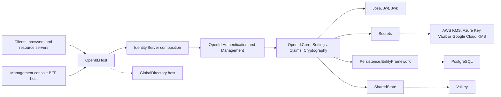

# Architecture

How NCode.Identity is built. [assurance-case.md](assurance-case.md) explains why the design meets its security
requirements.

## Components

The packages, hosts, analyzers and web apps, and the folder each lives in, are listed in
[AGENTS.md](../AGENTS.md#layout). [capabilities/](capabilities/README.md) describes each capability's architecture, with
the decisions and code behind it.

| Component | Role |
| --- | --- |
| **Foundation** | The JSON value model and serializer of `NCode.Identity.Json`, the time primitives of `NCode.Identity.Time` and the page, response and host security of `NCode.Identity.AspNetCore(.Abstractions)`, which any package may reference. |
| **JOSE / JWT** | The key, key set and thumbprint model of `NCode.Identity.Jwk`, with the JOSE and JWT libraries `NCode.Identity.Jose(.Abstractions)` and `NCode.Identity.Jwt(.Abstractions)` and the opt-in algorithm packages `NCode.Identity.Jose.EdDsa` and `NCode.Identity.Jose.Secp256k1` and the opt-in `NCode.Identity.Jose.SdJwt`. |
| **COSE / CWT** | The opt-in `NCode.Identity.Cose(.Abstractions)` for CBOR Object Signing and Encryption and the opt-in `NCode.Identity.Cwt(.Abstractions)` for CBOR Web Tokens over it. |
| **Secrets** | The stored-secret libraries `NCode.Identity.Secrets(.Abstractions)` and `NCode.Identity.Secrets.Persistence(.Abstractions)` and the opt-in KMS adapters `NCode.Identity.Secrets.AwsKms`, `NCode.Identity.Secrets.AzureKeyVault` and `NCode.Identity.Secrets.GoogleCloudKms` wrap root keys and hold the remote keys of tenants, protocol clients and BFFs. |
| **OpenID** | The OP's environments, errors, messages, endpoints, grant handlers, management API and Entity Framework persistence live in `NCode.Identity.OpenId.Abstractions`, `NCode.Identity.OpenId.Core`, `NCode.Identity.OpenId.Authentication(.Abstractions)`, `NCode.Identity.OpenId.Management(.Abstractions)`, `NCode.Identity.OpenId.Messages.Abstractions`, `NCode.Identity.OpenId.Persistence(.Abstractions)`, `NCode.Identity.OpenId.Persistence.EntityFramework` and its slices `NCode.Identity.OpenId.Persistence.EntityFramework.Core` and `NCode.Identity.OpenId.Persistence.EntityFramework.Accounts`, and the OAuth and OpenID Connect wire vocabulary lives in the dependency-free `NCode.Identity.OpenId.Protocol.Abstractions`. |
| **Accounts** | Local accounts sit behind one store seam in `NCode.Identity.OpenId.Accounts(.Abstractions)`, `NCode.Identity.OpenId.Accounts.AspNetIdentity`, `NCode.Identity.OpenId.Accounts.AspNetIdentity.EntityFrameworkCore`, `NCode.Identity.OpenId.Accounts.Authentication` and `NCode.Identity.OpenId.Accounts.Management(.Abstractions)`. |
| **Directory** | The global directory of `NCode.Identity.OpenId.GlobalDirectory(.Abstractions)` and `NCode.Identity.OpenId.GlobalDirectory.Server` reserves tenant and team identifiers platform-wide, places each tenant in a cell and publishes team documents. |
| **Interactive login and consent** | The opt-in `NCode.Identity.OpenId.Authentication.Interactive(.Abstractions)` is the sign-in, consent and account surface that the OP serves from the `apps/auth` bundle, with a pluggable credential verifier. |
| **Instance setup** | The one-time `/setup` wizard and `setup` command of `NCode.Identity.OpenId.Setup(.Abstractions)` create the root administrator. |
| **OpenID protocol client** | The OAuth 2.0 and OIDC client for server-side callers is `NCode.Identity.OpenId.Client(.Abstractions)`, built on the family's JOSE stack. |
| **Backend for frontend** | `NCode.Identity.Bff(.Abstractions)` makes an ASP.NET Core app the confidential client of its browser frontend, `NCode.Identity.Bff.Server` is its turnkey composition root, `NCode.Identity.Bff.Blazor` and `NCode.Identity.Bff.Blazor.Client` are the opt-in Blazor packages, `NCode.Identity.Bff.Protocol.Abstractions` holds the names the server and the WebAssembly client share, and `NCode.Identity.ManagementConsole` composes the management console's BFF host. |
| **Settings, claims and cryptography** | `NCode.Identity.Settings(.Abstractions)`, `NCode.Identity.Claims(.Abstractions)` and `NCode.Identity.Cryptography(.Abstractions)` are each registered by their own `Add…Library()` and composed under `AddOpenIdCoreLibrary`. |
| **Persistence** | `NCode.Identity.Persistence.Abstractions` holds every persistence contract and the UUIDv7 default of the surrogate key generator. |
| **Infrastructure ports** | `NCode.Identity.Dispatch(.Abstractions)` runs background jobs, `NCode.Identity.Events(.Abstractions)` carries events, `NCode.Identity.Mail(.Abstractions)` sends mail with its MIME form `NCode.Identity.Mail.Mime` and its opt-in `NCode.Identity.Mail.Smtp` and `NCode.Identity.Mail.AmazonSes` adapters ([ADR-1532](decisions/1532-outbound-mail-is-a-port-that-composes-each-queued-message-at-delivery-for-a-replaceable-transport-with-smtp-and-amazon-ses-adapters.md)), and `NCode.Identity.SharedState(.Abstractions)` holds the state every replica sees, with its opt-in `NCode.Identity.SharedState.Valkey` adapter. |
| **Composition** | `NCode.Identity.Registration` and `NCode.Identity.Registration.AspNetCore` hold the service builder and the endpoint registration, `NCode.Identity.Server` provides `AddIdentityServer()`, and the opt-in `NCode.Identity.AspNetCore.OpenTelemetry` registers the OpenTelemetry metrics that only a host references. |
| **Hosts (`hosts/`)** | The deployables, which no package ships, are `NCode.Identity.OpenId.Host`, `NCode.Identity.OpenId.Host.Database`, `NCode.Identity.OpenId.Host.MigrationService`, `NCode.Identity.ManagementConsole.Host`, `NCode.Identity.OpenId.GlobalDirectory.Host` and `NCode.Identity.OpenId.LocalDev`. |
| **Build analyzers** | `NCode.Identity.Analyzers`, under `analyzers/`, holds the repository's own Roslyn analyzers `NCID0001`, `NCID0004`, `NCID0005` and `NCID0006`, which every project's build loads and no package ships. |
| **Frontend (`frontend/`)** | The pnpm workspace of the web apps `apps/auth`, `apps/conformance`, `apps/conformance-runner`, `apps/mgmt`, `apps/playground` and `apps/setup` and their shared `@ncodegroup/identity-*` packages is themed with NCode Brand's Instrument. |

## Design Rules

- Decisions the design rests on are recorded in [decisions/](decisions/README.md).
- Warnings are errors
  ([project-template ADR-0100](decisions/project-template/0100-warnings-are-errors-in-every-project.md)), and disallowed
  APIs are banned at build time
  ([project-template ADR-0102](decisions/project-template/0102-disallowed-apis-are-banned-at-build-time.md)).
- Behavior is a service, a strategy collection or a mediator seam
  ([ADR-1001](decisions/1001-behavior-is-a-service-a-strategy-collection-or-a-mediator-seam-chosen-by-one-ladder.md)),
  and vocabularies are open unless provably closed
  ([ADR-1150](decisions/1150-vocabularies-are-open-unless-provably-closed.md)).
- Every capability is an `.Abstractions` and implementation pair under the `NCode.Identity` prefix
  ([ADR-1500](decisions/1500-every-package-names-one-capability-under-the-ncode-identity-prefix-as-an-abstractions-and-implementation-pair.md)),
  and DI registration proves every prerequisite at compile time
  ([ADR-1069](decisions/1069-di-registration-proves-every-prerequisite-at-compile-time-through-marker-builders.md)).
- Settings merge down the platform, team, tenant, resource-server and client scopes as ceilings and floors over a secure
  baseline
  ([ADR-1010](decisions/1010-settings-merge-as-ceilings-and-floors-unset-lists-restrict-nothing-and-a-secure-baseline-supplies-defaults.md),
  [ADR-1148](decisions/1148-a-scope-selects-security-profiles-that-accumulate-down-the-cascade-as-ceilings-defaults-and-requirements.md)).
- Tenant-bound rows are scoped at the persistence layer
  ([ADR-1018](decisions/1018-tenant-selection-is-shared-and-tenant-bound-rows-are-scoped-at-the-persistence-layer.md)),
  an Entity Framework persistence framework that domain slices plug into
  ([ADR-1052](decisions/1052-entity-framework-persistence-is-a-reusable-framework-that-domain-slices-plug-into.md)).
- Stored secrets live under a key hierarchy with an external root key
  ([ADR-1235](decisions/1235-stored-secrets-and-grant-payloads-are-protected-by-a-key-hierarchy-under-an-external-root-key.md)).
- A surrogate key never reaches a caller
  ([ADR-1517](decisions/1517-internal-surrogate-keys-are-uuidv7-minted-in-process-behind-one-seam-and-never-reach-a-caller.md)).
- A host runs the deployment posture unless configured for local development
  ([ADR-1370](decisions/1370-a-host-runs-the-deployment-posture-unless-configured-for-local-development-and-always-names-its-root-key-provider.md)).

## Build and Release

CI runs the Definition of Done, `./build/dod.ps1`, on every pull request, in the merge queue and on each push to `main`
or a release line (`.github/workflows/ci.yml`), and `.github/workflows/frontend.yml` gates the web apps' workspace.
Releases are cut from `release/vX.Y` lines and published as [GOVERNANCE.md](../GOVERNANCE.md#releases-branches--tags)
describes; `AGENTS.md`'s Landing section says `release: none`, so no plan tags a release.
