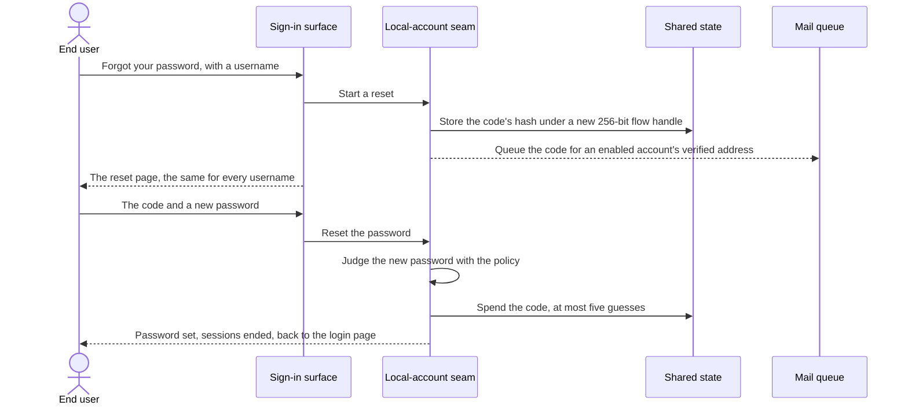

# Email Codes

> **An end user verifies an email address, resets a forgotten password and signs in with a second factor, each with a
> six-digit code mailed to the account.** Every flow is off until the tenant turns it on, a code is kept only as a hash,
> and nothing a page says reveals whether an account exists.

|                    |                                                                                                                                                                                                                                        |
| ------------------ | -------------------------------------------------------------------------------------------------------------------------------------------------------------------------------------------------------------------------------------- |
| **Status**         | Available for local accounts                                                                                                                                                                                                           |
| **Packages**       | `NCode.Identity.Mail(.Abstractions)` (the mail port), `NCode.Identity.Mail.Mime` (the MIME form of a message), `NCode.Identity.Mail.Smtp` and `NCode.Identity.Mail.AmazonSes` (the opt-in transports), `NCode.Identity.OpenId.Authentication.Interactive` (the pages and seams), `NCode.Identity.OpenId.Accounts.Authentication` (the local-account implementations) |
| **Key decisions**  | [ADR-1532](../decisions/1532-outbound-mail-is-a-port-that-composes-each-queued-message-at-delivery-for-a-replaceable-transport-with-smtp-and-amazon-ses-adapters.md), [ADR-1533](../decisions/1533-an-end-user-verifies-an-email-address-resets-a-password-and-signs-in-with-a-second-factor-through-one-time-email-codes.md) |
| **Operator guide** | The host README's [`## Outbound mail`](../../hosts/NCode.Identity.OpenId.Host/README.md#outbound-mail)                                                                                                                                 |

## The promises

|     | Promise                                                                                                                                                                                                              |
| --- | -------------------------------------------------------------------------------------------------------------------------------------------------------------------------------------------------------------------- |
| 1   | A code is six digits from a cryptographic random generator, kept in shared state only as a SHA-256 hash bound to its flow, valid for 10 minutes by default, used once, and ended by the fifth guess, each counted before it is judged, so racing guesses gain nothing. |
| 2   | An account receives at most five codes an hour for one purpose by default, so a guesser gets at most 25 tries an hour at a space of a million.                                                                         |
| 3   | A password reset is off by default. The same page answers every username, a code goes only to an enabled account's verified address, the password policy judges the new password before the code is spent, and a reset ends the account's sessions. |
| 4   | An email verification is off by default. The account page sends a code to the account's address and marks the address verified when the code comes back.                                                              |
| 5   | An email second factor is off by default and a team can require it but a tenant can't lift it. The password and the end user's standing are judged first, and a right code adds `otp` and `mfa` to the session's `amr`. |
| 6   | A message is queued, never sent inside the request, so a slow mail provider never stalls a page and a page's timing says nothing about the account.                                                                  |

## Why this matters

A password is the one credential an end user can lose, and a tenant that can't reset it for them hands every forgotten
password to an administrator. The usual fix, a mailed link, is also the usual weakness: mail scanners follow links and
spend them, a link opens in any browser, and a reset page that answers differently for a known username tells an
attacker which accounts exist. A short code that is entered on the page that asked for it, checked against a hash, and
limited in guesses and in sends gives the end user the convenience without those holes. The same code proves that an
address is a mailbox the end user reads, and, when a tenant requires it, proves it again at every sign-in.

## How it works, in one picture

1. The forgot-password page asks for a username and starts a flow whatever the username names, so the next page is the
   same for every username.
2. For an enabled account with a verified address, the seam stores the SHA-256 hash of `{flowId}:{code}` in shared state
   and queues the mail; for any other username it stores and sends nothing.
3. The reset page carries the flow handle, so the code alone opens nothing, and it takes the code and the new password.
4. The seam judges the password with the password policy before it spends the code, so a rejected password leaves the
   code unspent.
5. A right code sets the password, ends every session of the account's principal, revokes its grants and clears its
   failed password attempts.

## Why this design

| Approach                                  | Survives a mail scanner | Bound to the page that asked | Timing hides the account |
| ----------------------------------------- | ----------------------- | ---------------------------- | ------------------------ |
| **A queued six-digit code (chosen)**      | Yes                     | Yes, through the flow handle | Yes, the send is queued  |
| A mailed link                             | No, a scanner spends it | No, it opens in any browser  | Yes, if queued           |
| A code sent inside the request            | Yes                     | Yes                          | No                       |

Options we rejected

- A link instead of a code, eight digits, a reset keyed by email address, a second factor sent only to a verified
  address, and TOTP or passkeys, which a later decision may add:
  [ADR-1533, Options considered](../decisions/1533-an-end-user-verifies-an-email-address-resets-a-password-and-signs-in-with-a-second-factor-through-one-time-email-codes.md#options-considered).
- A provider's HTTP API as the default, `System.Net.Mail.SmtpClient`, sending inside the request, and a mail outbox
  table:
  [ADR-1532, Options considered](../decisions/1532-outbound-mail-is-a-port-that-composes-each-queued-message-at-delivery-for-a-replaceable-transport-with-smtp-and-amazon-ses-adapters.md#options-considered).

## The code

A code is six decimal digits. The server keeps only a SHA-256 hash of `{flowId}:{code}` in the shared-state port's
expiring value set, so a code is never stored, and every replica sees it. The flow handle is 256 bits, random, and rides
on the page that started the flow. The `email_code_lifetime` setting (10 minutes by default, from 1 minute to 1 hour)
sets how long a code is accepted, and `email_code_sends_per_hour` (5 by default, from 1 to 20) bounds how many codes one
account receives for one purpose in an hour. Both merge with `Min`, so a narrower scope may only shorten the lifetime or
lower the count. A flow is spent by one atomic take of its value, after every check has passed and before its effect, so
two requests that present the right code at once never both run the effect. A code is bound to the address it was mailed
to, which the flow's state records, and it authorizes nothing once the account's address differs, so an administrator
who changes the address while a code is outstanding leaves the old mailbox unable to verify the new address, reset the
password or pass the second factor.

> [!TIP]
> [ADR-1533](../decisions/1533-an-end-user-verifies-an-email-address-resets-a-password-and-signs-in-with-a-second-factor-through-one-time-email-codes.md),
> `DefaultEmailCodeSettingDescriptorDataSource`, `LocalAccountInteractivePasswordResetter`.

## Resetting a password

`password_reset_enabled` (`Replace`, off by default) adds a "Forgot your password?" link to the login page. The form
asks for the username, and the next page is the same for every username, so a page never says whether an account exists.
A code goes only to an enabled account's verified address. Any other username gets a decoy flow that refuses every code,
and the decoy's entries in shared state expire within a minute, so a flood of names cannot fill it. The reset page takes
the code and the new password, the password policy judges the password before the code is spent, and a right code sets
the password, ends the account's sessions, revokes its grants and clears its failed password attempts. The end user
returns to the login page. Both pages have the no-JavaScript baseline the login page has.

> [!TIP]
> [ADR-1533](../decisions/1533-an-end-user-verifies-an-email-address-resets-a-password-and-signs-in-with-a-second-factor-through-one-time-email-codes.md),
> `IInteractivePasswordResetter`, `LocalAccountInteractivePasswordResetter`.

## Verifying an address

`email_verification_enabled` (`Replace`, off by default) adds a link on the account page to the email page. The page
sends a code to the account's address and, when the code comes back, marks the address verified. The email page is a
bundle page, as the change-password page is.

> [!TIP]
> [ADR-1533](../decisions/1533-an-end-user-verifies-an-email-address-resets-a-password-and-signs-in-with-a-second-factor-through-one-time-email-codes.md),
> `IInteractiveEmailVerifier`, `LocalAccountInteractiveEmailVerifier`.

## The second factor

`email_mfa_required` (`Or`, off by default) lets a team require the factor and keeps a tenant from lifting it. After the
password and the end user's standing pass, the surface holds the verified principal in the data-protected cookie
`__Host-NCode.Identity.Interactive.PendingSignIn` (15 minutes, `SameSite=Strict`) and mails a code to the account's
address, verified or not, because the code proves the mailbox and a right code marks it verified. An account without an
address is refused with `access_denied`. A right code adds `otp` and `mfa` to `amr` and creates the session. The
resource-owner password grant is refused for a tenant that requires the factor, before it verifies a password, because
the grant cannot carry a code. The sign-in-code page has the no-JavaScript baseline.

> [!TIP]
> [ADR-1533](../decisions/1533-an-end-user-verifies-an-email-address-resets-a-password-and-signs-in-with-a-second-factor-through-one-time-email-codes.md),
> `IInteractiveSignInCodeChallenge`, `LocalAccountInteractiveSignInCodeChallenge`.

## The mail transport

A flow hands the mail's model to `IMailSender`, which refuses a model that no registered `IMailComposer` handles, queues
the model through the job dispatcher and returns. At each delivery attempt the model's composer builds the message, so a
code is a number until a sensitive buffer writes it, `IMailTransport` delivers the message, and the handler disposes it.
A delivery is tried four times, backing off from five seconds to one minute, so a code still arrives within its
lifetime. A message's bodies and attachments are `MailContent`, streams that the message owns and never byte arrays or
strings, and `NCode.Identity.Mail.Mime` builds the MIME form that both transports send. `NCode.Identity.Mail.Smtp` is
the transport a host opts into with the `Mail:Smtp` section, and `NCode.Identity.Mail.AmazonSes` is the one it opts into
with the `Mail:AmazonSes` section, which sends through the Amazon SES v2 API as the pod's AWS role and reports a refusal
as its error code and status only; a host configures one of them. Without a transport section the default transport
refuses every message, each failed delivery is logged, and a tenant keeps the three settings off. The sender address
belongs to the transport, because the provider authorizes it. `Tls` is `StartTls` or `ImplicitTls`, and `None` sends in
clear, so the SMTP options validator refuses it, in any spelling that binds to it, unless `LocalDevelopment:Enabled` is
set, for the local stack's mail catcher. The mail is worded in every shipped locale and in the tenant's branding display
name, and a log never writes a recipient or a body. See [metrics](../metrics.md#ncodeidentitymailmessages) for the
delivery counter.

> [!TIP]
> [ADR-1532](../decisions/1532-outbound-mail-is-a-port-that-composes-each-queued-message-at-delivery-for-a-replaceable-transport-with-smtp-and-amazon-ses-adapters.md),
> `IMailSender`, `IMailComposer`, `IMailTransport`, `MailDeliveryJobHandler`, `SmtpMailTransport`,
> `AmazonSesMailTransport`.

## Audit

Each flow is audited in the `authentication` category, with the account as the `local_account` resource and no password,
code or address: `password.change` records an end user's change of their password, `password.reset_request` the request
for a reset code, `password.reset` the reset itself, `email.verification` the verification of an address, and
`subject.second_factor` the second factor at sign-in, whose `details.factor` is `email_code`. Each is a success or a
failure with an `error.code`, and an unknown username's reset request is a failure with `details.attempted_username` and
no subject. The code sends for a verification are not audited, and a refused second-factor send is, because it blocks a
sign-in. Nothing is recorded while a flow's setting is off. See the [audit records](../audit-records.md) for the fields.

> [!TIP]
> [ADR-1533](../decisions/1533-an-end-user-verifies-an-email-address-resets-a-password-and-signs-in-with-a-second-factor-through-one-time-email-codes.md),
> `IAuditEventRecorder`, `AuditCredentialFactors`.

## Limits and roadmap

- **Email is not a second factor at AAL2.** NIST SP 800-63B does not accept email as an out-of-band authenticator, so
  the session's `acr` is not raised.
- **A replica that stops loses the codes it holds.** The in-process dispatcher keeps a queued message in memory, so the
  end user asks for another code; a durable dispatcher would keep it, code included, until it is delivered
  ([#25](https://github.com/NCodeGroup/identity/issues/25)).
- **A host without a transport section sends no mail.** Its tenants keep the three settings off.
- **The flows serve local accounts.** The surface's seams support nothing until a backend implements them, and the
  local-account capability is the one that does.
- **TOTP and passkeys are not built.** They are stronger factors that need enrollment.

## Further reading

- Decisions:
  [ADR-1532](../decisions/1532-outbound-mail-is-a-port-that-composes-each-queued-message-at-delivery-for-a-replaceable-transport-with-smtp-and-amazon-ses-adapters.md),
  [ADR-1533](../decisions/1533-an-end-user-verifies-an-email-address-resets-a-password-and-signs-in-with-a-second-factor-through-one-time-email-codes.md),
  [ADR-1528](../decisions/1528-the-hosted-platform-sends-its-mail-through-amazon-ses-in-each-cells-region-from-mail-ncodeid-net.md),
  [ADR-1230](../decisions/1230-an-end-user-changes-their-password-through-an-optional-seam-and-keeps-only-the-current-session.md),
  [ADR-1236](../decisions/1236-a-password-is-judged-by-one-policy-wherever-it-is-set.md)
- Code: [`NCode.Identity.Mail`](../../src/NCode.Identity.Mail),
  [`NCode.Identity.Mail.Mime`](../../src/NCode.Identity.Mail.Mime),
  [`NCode.Identity.Mail.Smtp`](../../src/NCode.Identity.Mail.Smtp),
  [`NCode.Identity.Mail.AmazonSes`](../../src/NCode.Identity.Mail.AmazonSes),
  [`LocalAccountInteractivePasswordResetter`](../../src/NCode.Identity.OpenId.Accounts.Authentication/LocalAccountInteractivePasswordResetter.cs),
  [`LocalAccountInteractiveEmailVerifier`](../../src/NCode.Identity.OpenId.Accounts.Authentication/LocalAccountInteractiveEmailVerifier.cs),
  [`LocalAccountInteractiveSignInCodeChallenge`](../../src/NCode.Identity.OpenId.Accounts.Authentication/LocalAccountInteractiveSignInCodeChallenge.cs)
