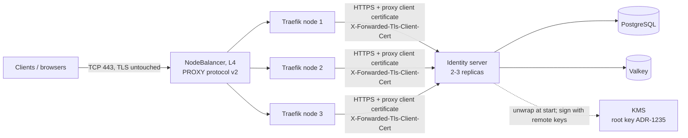

# Hosting — the hosted platform's topology, capacity and growth path

- **Status:** Decided. [ADR-1520](decisions/1520-the-hosted-platform-runs-production-on-akamai-lke-in-washington-dc-and-its-lab-on-oci-oke-basic-in-phoenix.md)
  records the topology, and each section names the record that decides it; [§13](#13-open-decisions) lists the
  decisions still open.
- **Prices captured:** 2026-10-18, list **monthly USD, excluding tax**, from each vendor's live pricing page or public
  read-only API (Akamai `api.linode.com/v4/*`); Akamai's US regions, their capabilities and regional prices re-checked
  2026-11-14. Prices drift — re-verify in the vendor console before purchase. Anything not verified live is marked
  _(verify)_.

The hosted platform is built to its operating principles — cattle not pets, immutable artifacts, everything as code,
stateless services, redundancy by default, proven recoverability, and secure by default
([ADR-1134](decisions/1134-the-platform-and-the-host-follow-written-cloud-native-operating-principles.md)). This page
holds the topology the records decide, the sizing, capacity and prices behind it, and the analysis that informs the
decisions still open.

## 1. Topology

Decided in
[ADR-1520](decisions/1520-the-hosted-platform-runs-production-on-akamai-lke-in-washington-dc-and-its-lab-on-oci-oke-basic-in-phoenix.md).

| Environment | Where it runs | What runs there |
| --- | --- | --- |
| **Production** | Akamai, Washington, DC (`us-iad`) | LKE on 4 × Linode 2 GB, control plane managed by Akamai; a NodeBalancer (L4, PROXY protocol v2) in front of Traefik; Akamai managed PostgreSQL, 3 × 1 GB nodes in the same datacenter; Valkey in the cluster (primary, replica and Sentinels); the root key in AWS KMS through web identity federation ([#177](https://github.com/NCodeGroup/identity/issues/177)) |
| **Lab** | OCI, Phoenix (`us-phoenix-1`) | OKE Basic on 2 × Ampere A1 (1 OCPU / 6 GB) in two availability domains, inside the free allowance; the free network load balancer; CloudNativePG and Valkey in the cluster; arm64 |
| **Daily development** | The developer's machine or a LAN-only homelab | The Aspire stack, or a k3s cluster that Flux runs; never under `ncodeid.net` |
| **Ephemeral runs** | Azure, on the Visual Studio credit | Conformance, load and topology runs, created and destroyed per run ([§8](#8-devtest-and-conformance-on-azure-visual-studio-credit)) |
| **Shared foundations** | AWS `us-west-2`, Cloudflare, GitHub | State, backups and vendor tokens ([ADR-1132](decisions/1132-platform-infrastructure-code-is-public-on-github-and-its-state-and-backups-live-in-aws.md)), DNS ([ADR-1495](decisions/1495-the-hosted-platform-runs-customer-environments-as-tenants-on-production-under-the-ncodeid-net-platform-domain.md)), source, CI and images ([ADR-1133](decisions/1133-the-hosted-platform-runs-only-the-published-artifacts-it-offers-self-hosters.md)) |

Production costs $95 a month at the developer plan, and $60 more once the cluster that hosts paid plans runs the HA
control plane ([Stages](#stages)). The root key costs about a dollar a month
([ADR-1235](decisions/1235-stored-secrets-and-grant-payloads-are-protected-by-a-key-hierarchy-under-an-external-root-key.md)).

### The production region

Production runs in Washington, DC (`us-iad`)
([ADR-1520](decisions/1520-the-hosted-platform-runs-production-on-akamai-lke-in-washington-dc-and-its-lab-on-oci-oke-basic-in-phoenix.md)).
Production serves customers, not the operator, so its region is chosen on four things, in order:

1. **The region's capabilities.** Akamai prices every US region the same: its public API lists regional price
   overrides only for Jakarta and São Paulo (checked 2026-11-14, `api.linode.com/v4/linode/types`, `/lke/types`,
   `/nodebalancers/types`), so the choice costs nothing. What differs is what each region offers:

   | Akamai US region | VPCs | Premium plans and NodeBalancers | LKE Enterprise logging listed | Managed PostgreSQL |
   |---|---|---|---|---|
   | Washington, DC (`us-iad`, `us-iad-2`) | ✓ | ✓ | ✓ | ✓ |
   | Chicago (`us-ord`) | ✓ | ✓ | ✓ | ✓ |
   | Seattle (`us-sea`), Los Angeles (`us-lax`) | ✓ | ✓ | ✓ | ✓ |
   | Miami (`us-mia`) | ✓ | ✓ | — | ✓ |
   | Dallas (`us-central`), Newark (`us-east`), Atlanta (`us-southeast`), Fremont (`us-west`) | — | — | — | ✓ |

   The capability list is from `api.linode.com/v4/regions` on 2026-11-14. LKE Enterprise is sold through Akamai sales
   in limited regions; a region listing its logging capability is a sign, not a promise, that it is offered there
   _(verify)_.
2. **Nearness to customers' backends.** Every token, introspection, revocation and back-channel call comes from a
   customer's server, and most SaaS backends run in or near AWS `us-east-1` (Northern Virginia). Akamai's Washington,
   DC region sits in the same metro, about 1–2 ms away _(measure)_.
3. **Nearness to customers' users.** Interactive sign-in is a few round trips, so tens of milliseconds matter little;
   the US population and network weight lean east, and a central region (Chicago) minimizes the worst case across
   both coasts.
4. **Its relation to the platform's other pieces.** Backups and OpenTofu state stay in AWS `us-west-2`, a different
   geography from either eastern region. Remote signing ([§9](#9-root-key-and-remote-keys--kms-adr-1235)) is on the
   request path, so its keys belong in the region nearest the cluster. And the growth path is AWS
   ([§15](#15-growth-path-aws)), whose largest region is `us-east-1`, so an eastern Akamai region keeps latency the same
   when cells later move there.

Chicago (`us-ord`) is the equal-cost, equal-capability alternative. Dallas is nearer Denver, but it is one of Akamai's
older regions, without VPCs, Premium plans, Premium NodeBalancers or LKE Enterprise. Only the lab sits near Denver,
where the operator works: OCI Phoenix, and Azure West Central US for ephemeral runs
([§8](#8-devtest-and-conformance-on-azure-visual-studio-credit)).

**Latency from where customers are** (typical ranges, not measurements):

| Cluster region                       | AWS `us-east-1` (most SaaS backends) | East-coast users | West-coast users |
| ------------------------------------ | ------------------------------------ | ---------------- | ---------------- |
| Washington, DC (Akamai `us-iad`)     | ~1–2 ms                              | ~5–20 ms         | ~60–70 ms        |
| Chicago (Akamai `us-ord`)            | ~15–20 ms                            | ~15–25 ms        | ~45–55 ms        |
| Dallas (Akamai `us-central`)         | ~30–35 ms                            | ~30–40 ms        | ~35–45 ms        |
| Seattle or Los Angeles (Akamai)      | ~60–70 ms                            | ~60–75 ms        | ~5–25 ms         |

A token request from a backend is one round trip plus server time, and an interactive sign-in is a few round trips, so
the backend column weighs most. Once customers exist, measure from where their requests come from (Grafana synthetic
checks from several US probes) before adding a second region.

### Environment model

Decided in [ADR-1495](decisions/1495-the-hosted-platform-runs-customer-environments-as-tenants-on-production-under-the-ncodeid-net-platform-domain.md).

- **Customer environments are tenants on production.** A customer's dev, test, and prod are separate tenants on the one
  production platform (the Auth0 model): `acme-dev.auth.{region}.ncodeid.net`,
  `acme-test.auth.{region}.ncodeid.net`, `acme.auth.{region}.ncodeid.net`. Their non-production runs on exactly the hardware, versions, and configuration their
  production does, so no customer incident can be blamed on environment drift, and promotion is tenant configuration
  (management API), not infrastructure.
- **The platform itself has two environments:** **production** — every customer tenant, plus the internal `canary`
  tenant for post-deploy smoke tests and the `conformance` tenant the OpenID Foundation's hosted certification suite
  runs against — and the **lab**, the platform owner's own rehearsal of release candidates and platform changes on
  public, cloud-shaped infrastructure,
  which never hosts a customer tenant. Certification runs on production because a certificate should describe what
  customers use: production's platform, configuration and release. Lab hosts carry a `lab` label
  (`auth.lab.ncodeid.net`) so a platform environment can't be confused with a customer's `-dev` tenant; `dev`, `test`,
  and `staging` are reserved for customers' tenants and never name a platform environment ([ADR-1495](decisions/1495-the-hosted-platform-runs-customer-environments-as-tenants-on-production-under-the-ncodeid-net-platform-domain.md)).
- **Daily development runs outside the platform,** on the developer's own machine (the Aspire stack) or a LAN-only
  homelab cluster. It never uses the platform domain, so no issuer under `ncodeid.net` ever points at a developer's
  network.
- **Production therefore carries customers' dev/test traffic too:** per-tenant rate limits
  ([ADR-1246](decisions/1246-rate-limits-are-registered-descriptors-counted-in-a-shared-expiring-counter-set.md)) and
  quotas ([ADR-1198](decisions/1198-a-daily-quota-counts-a-utc-day-and-a-tier-may-admit-a-bounded-billed-overage.md))
  keep one tenant's load test from starving another.

### Stages

The platform grows in stages, decided in
[ADR-1520](decisions/1520-the-hosted-platform-runs-production-on-akamai-lke-in-washington-dc-and-its-lab-on-oci-oke-basic-in-phoenix.md).
The starting budget is about **$100/month all-in**, for the lab and a production platform that offers only the free,
non-production developer plan; paid plans, and the availability they need, are paid for by the plans that need them.

0. **Daily development — a LAN-only homelab, $0.** A k3s cluster at home, already run by Flux with Traefik,
   cert-manager (DNS-01, so LAN hosts get real Let's Encrypt certificates), a bare-metal load balancer, distributed
   storage and S3 backups, takes every build of `main` (or a local build) on hostnames under the homelab's own domain.
   It has the same Kubernetes layer as production, LAN latency, and no cloud bill, so it is where day-to-day changes are
   tried. It may run `LocalDevelopment:Enabled` for seeders and developer keys, and use the `local` root-key provider,
   because its service-account issuer is not public and AWS web identity federation can't reach it. Nothing outside
   the LAN can reach it: not the OpenID Foundation's hosted suite, an external relying party's back-channel logout, or
   any other inbound call from the internet. Keep the identity server off any single-sign-on proxy in front of other
   homelab apps, which would break the protocol endpoints.
1. **The lab, $0/month.** One OKE Basic cluster (no charge for its managed control plane; only Enhanced clusters cost
   $0.10 an hour) in Phoenix, near the operator, in a Pay-As-You-Go tenancy, behind the free network load balancer.
   Every OCI tenancy, free or paid, gets the first **1,500 A1 OCPU-hours and 9,000 GB-hours a month** free in its home
   region — 2 OCPU and 12 GB running all month (Oracle's
   [Always Free resources](https://docs.oracle.com/en-us/iaas/Content/FreeTier/freetier_topic-Always_Free_Resources.htm),
   checked 2026-11-14; its public price list still shows the older 3,000 and 18,000, so check the tenancy's console).

   The lab's node pool is **2 × (1 OCPU / 6 GB) in two availability domains, $0**: the whole free allowance, and about
   94 GB of the 200 GB free block storage for boot volumes. Beyond the allowance, A1 costs $0.01 per OCPU-hour and
   $0.0015 per GB-hour, so a third node in a third availability domain (3 × 1 OCPU / 4 GB) costs about $7.30 a month.

   With daily development on the homelab, the lab is the **public, cloud-shaped rehearsal before production**: it takes
   release candidates deliberately rather than every build, always runs the deployment posture, and proves what the
   homelab can't — the OpenTofu modules and a managed cluster's upgrades, ingress and mTLS from the internet, and
   inbound calls from external parties. It runs one deployment, with a CloudNativePG database and Valkey, in about 4–6
   GB. Its memory use keeps it above the 20% that Oracle's idle-instance rule looks for, so it is not reclaimed as idle.
   Rehearsals that need three or more nodes — node loss, zone spread, load tests — run on the Azure Visual Studio credit
   ([§10](#10-devtest-and-conformance-on-azure-visual-studio-credit), $0). The Kubernetes layer (Traefik, chart, app)
   is identical to production; only the cluster, load balancer and database modules differ. Publish multi-arch (amd64 +
   arm64) images.
2. **The developer plan — production, ~$95/month.** Production in Washington, DC without the HA control plane: LKE with
   4 × 2 GB nodes ($48), a NodeBalancer ($10) and the 3-node 1 GB managed PostgreSQL ($37). Free developer tenants are
   non-production and carry no SLA, so the single-replica control plane is acceptable: if it fails, the running pods
   keep serving and only deploys and recovery pause. The database is the one component bought at its HA size from the
   start, because it is the system of record and a 1-node cluster may not grow to 3 nodes in place _(verify)_.
3. **Before the first paid plan — +$60/month.** Create a new LKE cluster with the HA control plane (+$60) and the same
   four nodes, and move the cell onto it: the managed database stays where it is, the release is deployed on the new
   cluster, and DNS is pointed at its load balancer, so no tenant changes
   ([§16](#which-cluster-each-cell-uses)). This avoids enabling HA in place, which replaces every node irreversibly.
4. **As the paid plans grow — AWS:** place new cells, then the paid cells, on AWS for multiple availability zones and
   the enterprise features the cheaper vendors lack ([§15](#15-growth-path-aws)).

Every release goes through the same steps: the conformance suite in CI against each build (the self-hosted OpenID
Foundation suite in Docker on a GitHub-hosted runner, [#124](https://github.com/NCodeGroup/identity/issues/124), $0),
the homelab with every build of `main`, the lab with each release candidate, then production, verified on its `canary`
tenant. Gate the production GitHub environment with required reviewers.

**Certification runs on production's `conformance` tenant.** Production is the stable, always-up, deliberately released
environment, so it needs no second copy in the lab, and the certificate then describes what customers use. The tenant
belongs to a team of its own, holds no customer data, and can stay disabled between certification runs, when it answers
`404` like any disabled tenant. Production runs the deployment posture, which refuses the config-driven conformance
seed, so the tenant, its clients and its test user are provisioned once through the management API by a script the
pipeline runs, with the test user's password kept as a secret.

| Monthly, at the developer-plan stage | Cost |
|---|---|
| Production: LKE 4 × 2 GB, NodeBalancer, 3-node 1 GB PostgreSQL | $95 |
| Lab: OKE Basic, 2 × A1 1 OCPU / 6 GB, network load balancer, block storage, all inside the free allowance | $0 |
| Homelab: the developer's own hardware, already running | $0 |
| AWS KMS root keys, one per deployment (2 × $1, plus $1 for each of a key's first two yearly rotations) | ~$2–3 |
| AWS S3 for OpenTofu state and backups | ~$1 |
| GitHub, Cloudflare DNS, Let's Encrypt, Grafana Cloud Free, OCI Email Delivery, the Azure credit | $0 |
| Domains (prepaid for ten years at registration) | $0 |
| **Total** | **~$98–99** |

**Where the budget goes.** The ~$12 that a third lab node would cost buys production's fourth node instead. On
3 × 2 GB nodes, losing a node — or LKE recycling one during a Kubernetes upgrade — leaves about 4 GB for about 4 GB of
pods, so some pods wait unscheduled until the node returns; a fourth node gives production that N-1 headroom, which
matters more on the platform developers use than in the lab. With three production nodes the total is ~$86–87, and a
third lab node adds ~$7.30. Watch Grafana Cloud's free 10k active series across production and the lab.

### Shared services

| Concern                                        | Service                                       | Free allowance (verified 2026-10-18 unless noted)                                                                        |
| ---------------------------------------------- | --------------------------------------------- | ------------------------------------------------------------------------------------------------------------------------ |
| Source, infrastructure code, CI, images        | GitHub Actions + GitHub Container Registry    | Free for public repositories and public packages, including environments with required reviewers ([ADR-1132](decisions/1132-platform-infrastructure-code-is-public-on-github-and-its-state-and-backups-live-in-aws.md)) |
| DNS                                            | Cloudflare DNS                                | Free plan, incl. DNSSEC; registrar stays at Porkbun. Keep identity hosts **DNS-only** — proxying would terminate TLS at Cloudflare and drop the client certificate |
| Server certificates                            | Let's Encrypt via cert-manager                | Free                                                                                                                     |
| OpenTofu state, Postgres backups, vendor tokens | AWS S3 + SSM Parameter Store (dedicated account) | **Not free — cents/month at this size:** S3 Standard $0.023/GB-month, $5/M writes, $0.40/M reads; SSM standard parameters free |
| Metrics, logs, traces, synthetics, load tests  | Grafana Cloud Free                            | 10k active series, 50 GB logs, 50 GB traces, 14-day retention, 3 users, 100k synthetic API checks, 500 k6 VU-hours       |
| Uptime alerts (alternative)                    | UptimeRobot Free                              | 50 monitors, 5-minute interval (positioned for hobby / non-profit use)                                                   |
| Signing keys on OCI (production-capable)       | OCI Vault                                     | Software keys free; first 20 HSM key versions free, then $0.5334/version/month                                           |
| Root key (ADR-1235)                            | AWS KMS (the platform's account)              | $1 per key per month (plus $1 for each of the first two yearly rotations) and $0.03 per 10,000 requests, 20,000 requests per month free _(verify)_ |
| Key Vault experiments, ephemeral conformance   | Azure via the Visual Studio credit            | $50/month, dev/test only ([§10](#10-devtest-and-conformance-on-azure-visual-studio-credit))                               |
| Inbound email (`security@`, vendor accounts)   | Cloudflare Email Routing                      | Free; receive-and-forward only (sending needs Workers Paid)                                                              |
| Outbound email, when needed                    | OCI Email Delivery                            | 3,000 emails/month                                                                                                       |

## 2. Reference architecture

Decided in
[ADR-1504](decisions/1504-the-hosts-serve-https-only-and-verify-their-certificate-at-startup.md),
[ADR-1506](decisions/1506-the-ingress-controller-holds-a-client-certificate-the-pods-can-require-and-never-read-as-an-end-clients.md),
[ADR-1507](decisions/1507-the-host-chart-routes-to-its-https-only-pods-through-gateway-api-a-traefik-ingress-or-the-operators-own-ingress.md)
and the records each point names.

- The load balancer is **L4 TCP pass-through** (never TLS-terminating, never an L7 or CDN proxy), so Traefik sees the
  client certificate; PROXY protocol v2 preserves the client IP.
- Traefik terminates TLS, **requests** the client certificate on the mTLS host, and forwards it with the
  `passTLSClientCert` middleware; the server reads it via `OpenId:MutualTls:CertificateHeaderName`
  ([ADR-1097](decisions/1097-access-tokens-are-sender-constrained-by-dpop-or-mutual-tls-through-one-proof-of-possession-seam.md)).
- Traefik reaches the pods over HTTPS on port 8443
  ([ADR-1504](decisions/1504-the-hosts-serve-https-only-and-verify-their-certificate-at-startup.md)): its
  `ServersTransport` verifies the pods' certificate against the ingress controller's Secret and presents that Secret's
  client certificate, which the pods can require
  ([ADR-1506](decisions/1506-the-ingress-controller-holds-a-client-certificate-the-pods-can-require-and-never-read-as-an-end-clients.md),
  [ADR-1507](decisions/1507-the-host-chart-routes-to-its-https-only-pods-through-gateway-api-a-traefik-ingress-or-the-operators-own-ingress.md)).
  A certificate the host verified as the proxy's is never read as an end client's, so the forwarded header stays the
  only source of the end client's certificate.
- RFC 8705 §5 mTLS endpoint aliases map naturally to a dedicated mTLS hostname (the tenant's
  `mtlsEndpointAliasAuthority`), so only that host asks for client certificates; per-tenant alias hosts route to their
  tenant ([ADR-1165](decisions/1165-a-tenants-stored-issuer-is-its-single-origin-and-its-mtls-alias-a-routed-second-host.md)).

### Domains and DNS

The platform names four domains
([ADR-1495](decisions/1495-the-hosted-platform-runs-customer-environments-as-tenants-on-production-under-the-ncodeid-net-platform-domain.md)):

| Domain              | Role                                                                          |
| ------------------- | ----------------------------------------------------------------------------- |
| `ncodeid.net`       | Platform domain: every issuer-bearing host                                    |
| `ncodeid.com`       | Brand domain: site, docs, status page and operator mail                       |
| `ncodeidentity.com` | Redirect-only, to `https://ncodeid.com`                                       |
| `ncodeidentity.net` | Redirect-only, to `https://ncodeid.com`                                       |

All four are registered at **Porkbun**; `ncodeid.net` and `ncodeid.com` are renewed to the registry's 10-year maximum.
DNS is hosted on **Cloudflare DNS (free)**, one zone per domain — Porkbun's managed DNS is not used.

**Manual steps** — the only ones outside IaC, each done once — are written step by step, with verification, in the
[platform bootstrap runbook](platform-bootstrap.md): registrar hardening at Porkbun, the GitHub organization and the
public infrastructure repository, the Cloudflare account and a short-lived bootstrap token, the AWS member account with
IAM Identity Center (home region `us-west-2`), the OCI tenancy for the lab (home region Phoenix), running the bootstrap
stack, the registrar delegation, and the email-routing verification.

**Bootstrap stack** ([ADR-1132](decisions/1132-platform-infrastructure-code-is-public-on-github-and-its-state-and-backups-live-in-aws.md)) — OpenTofu run once
from the owner's machine with those short-lived credentials (local state, then migrated into the bucket it creates):
the S3 **state bucket** (versioning, encryption, public-access block, TLS-only policy) and **backup bucket** (Object
Lock in compliance mode, archive lifecycle); the GitHub OIDC provider with a read-only **plan** role and an **apply**
role that trusts only the repository's protected `production` environment; the zones (`cloudflare_zone`, which outputs
the nameservers) and DNSSEC (`cloudflare_zone_dnssec`, which outputs the DS record); scoped Cloudflare tokens
(`cloudflare_account_token`) stored as SSM `SecureString`s; and, through `integrations/github`, the repository's
environments and rulesets. Revoke the bootstrap token afterwards.

**Everything else is OpenTofu** (official `cloudflare/cloudflare` provider) from GitHub Actions in the public
`NCodeGroup/identity-platform` repository, with zone-scoped tokens read from SSM — one for OpenTofu, a separate
DNS-edit-only token for certificate issuance: DNS records (`cloudflare_dns_record`), zone settings
(`cloudflare_zone_setting`), Email Routing, and notification policies. Records that track cluster IPs can alternatively
be owned by external-dns in-cluster.

**Certificates:** cert-manager with the Cloudflare DNS-01 solver issues Let's Encrypt certificates (wildcards included)
into Kubernetes Secrets that Traefik serves. Traefik's built-in ACME client keeps state per instance and doesn't share
it across 3 replicas, so it isn't used.

**Hostnames** — the issuer URL is baked into every client's configuration, so choose these once (decided in
[ADR-1495](decisions/1495-the-hosted-platform-runs-customer-environments-as-tenants-on-production-under-the-ncodeid-net-platform-domain.md)). The scheme uses
**functional namespaces** under the apex — `auth` for the OpenID protocol, `mtls` for its certificate-bound aliases,
`manage` for the management console — mirroring Auth0 (`{tenant}.us.auth0.com` for tenants, `manage.auth0.com` for the
dashboard). The platform's hosts live on `ncodeid.net`, which carries nothing else, and the site, docs, status page
and mail live on `ncodeid.com` ([ADR-1495](decisions/1495-the-hosted-platform-runs-customer-environments-as-tenants-on-production-under-the-ncodeid-net-platform-domain.md)):

| Hostname                                        | Serves                                                                                                   | Certificate                    |
| ----------------------------------------------- | -------------------------------------------------------------------------------------------------------- | ------------------------------ |
| `auth.ncodeid.net`                              | Root (control-plane) tenant issuer — where admins sign in and management-API tokens are issued ([ADR-1417](decisions/1417-management-authority-is-a-role-assignment-at-a-node-of-the-platform-team-and-tenant-hierarchy.md)) | `auth.ncodeid.net`            |
| `{tenant}.auth.{region}.ncodeid.net`            | Workload tenant issuers of one region, resolved by `DynamicByHost` (e.g. `acme.auth.{region}.ncodeid.net`) | `*.auth.{region}.ncodeid.net` |
| `mtls.ncodeid.net`, `{tenant}.mtls.{region}.ncodeid.net` | RFC 8705 mTLS endpoint aliases — the only hosts where Traefik requests a client certificate. `DynamicByHost` routes each tenant's alias host to it (ADR-1165) | `mtls.…` + `*.mtls.{region}.ncodeid.net` |
| `manage.ncodeid.net`                            | The management console only; the management API is `/api` on `auth.ncodeid.net` ([ADR-1437](decisions/1437-the-management-console-is-a-confidential-client-whose-own-bff-host-serves-only-the-console.md)) | `manage.ncodeid.net`          |
| `ncodeid.net`, `www.ncodeid.net`                  | Redirect (301) to `https://ncodeid.com`, with the HSTS header                                            | `ncodeid.net` + `www.ncodeid.net` (cert-manager) |
| `ncodeid.com`, `www.ncodeid.com`, `status.ncodeid.com` | Project site, docs and status page — the brand domain ([ADR-1495](decisions/1495-the-hosted-platform-runs-customer-environments-as-tenants-on-production-under-the-ncodeid-net-platform-domain.md)) | Hosting provider               |

Why this shape:

- **`auth`, not `id` or `login`:** the hosts serve machine-to-machine token, discovery, and JWKS endpoints as well as
  the login UI, and `auth.<domain>` is the convention developers expect.
- **Tenants nest under a function label and a region rather than the apex** (`acme.auth.{region}.ncodeid.net`, not
  `acme.ncodeid.net`): no tenant name can ever collide with a service host (`www`, `manage`, `mtls`, `status`, `docs`,
  `dev`, …), so there is no reserved-name list to maintain, and each function in each region gets one wildcard
  certificate. `{region}` is the region of the cell that hosts the tenant, so the hostname names where the tenant's
  data lives and resolves to a cell of that region. The root issuer and the control plane sit at `auth.ncodeid.net`, in
  the control-plane cell, and carry no region label. A tenant of a dedicated cell, or a tenant that changes cell within
  its region ([ADR-1411](decisions/1411-a-platform-is-a-global-directory-over-independent-cells-and-a-cells-tenants-share-one-database.md)),
  keeps its issuer through an explicit DNS record for its hostname
  ([#755](https://github.com/NCodeGroup/identity/issues/755)); custom domains are a separate decision
  ([#756](https://github.com/NCodeGroup/identity/issues/756)).
- **`mtls` is a sibling namespace, not `mtls.{tenant}.auth…`:** a wildcard covers one label only, so nesting would need a
  certificate per tenant.
- **`manage` is separate from `auth`:** the management console is a confidential client with a BFF host and origin of
  its own, so it gets its own CORS, rate-limit, and IP-allow-list policy at Traefik, and calls the management API at
  `/api` on `auth` ([ADR-1437](decisions/1437-the-management-console-is-a-confidential-client-whose-own-bff-host-serves-only-the-console.md)).
- **Custom domains later** (Auth0 parity): the tenant's issuer is its single origin — it both routes the tenant and
  anchors every published URL ([ADR-1165](decisions/1165-a-tenants-stored-issuer-is-its-single-origin-and-its-mtls-alias-a-routed-second-host.md)) — so a
  custom domain (`login.customer.com`, CNAME'd to the platform) *becomes* the tenant's issuer. Choose it before clients
  integrate; cert-manager issues its certificate over HTTP-01.
- **The server derives these hosts from configuration**
  ([ADR-1165](decisions/1165-a-tenants-stored-issuer-is-its-single-origin-and-its-mtls-alias-a-routed-second-host.md)):
  `OpenId:TenantResolution:StrategyCode = DynamicByHost`, `DynamicByHost:IssuerTemplate =
  https://{tenantId}.auth.{region}.ncodeid.net` with the cell's own region written in, and `Root:Issuer =
  https://auth.ncodeid.net`. A tenant created without an issuer is given (and keeps) the one the template derives; a
  custom domain is set as an explicit issuer. The mTLS aliases follow the same rule:
  `DynamicByHost:MtlsEndpointAliasTemplate = https://{tenantId}.mtls.{region}.ncodeid.net` and
  `Root:MtlsEndpointAliasAuthority = https://mtls.ncodeid.net`
  ([ADR-1165](decisions/1165-a-tenants-stored-issuer-is-its-single-origin-and-its-mtls-alias-a-routed-second-host.md)). The root tenant
  is created when the first request reaches `auth.ncodeid.net`
  ([ADR-1166](decisions/1166-a-tenant-is-created-and-seeded-through-one-provisioning-pipeline-under-every-strategy.md)),
  and its first administrator is created once through `/setup` on that host
  ([ADR-1512](decisions/1512-an-instance-is-set-up-once-through-a-one-time-setup-token-that-creates-a-root-global-administrator.md),
  [first use of a deployed instance](first-deployed-instance.md)); `BootstrapAdmin` is development-only, and a
  host without `LocalDevelopment:Enabled` refuses it. `/api` is served on
  `auth.ncodeid.net`, the control-plane tenant's origin, because the OP accepts the console's DPoP-bound call only at
  that origin plus `/api` ([ADR-1437](decisions/1437-the-management-console-is-a-confidential-client-whose-own-bff-host-serves-only-the-console.md)); the API authenticates by the control-plane tenant whichever host or path addresses it
  ([ADR-1191](decisions/1191-a-management-request-is-authenticated-by-the-control-plane-tenant-and-scoped-by-its-routes-tenant.md)).

**Environments.** Customer environments are just tenants on production (`acme-dev.auth.{region}.ncodeid.net`), so they need no
extra hostnames. The platform's private **lab** inserts a `lab` label after the function: `auth.lab.ncodeid.net`,
`{tenant}.auth.lab.ncodeid.net`, `{tenant}.mtls.lab.ncodeid.net`, `manage.lab.ncodeid.net`. Ephemeral Azure runs use
one host each, `{run}.ci.ncodeid.net`. The lab shares the platform zone, so it must never hold a token that can edit
it: only the OpenTofu pipeline writes DNS (production changes gated by required reviewers), and lab/CI clusters obtain
certificates over HTTP-01 for their specific hosts — or, if they need wildcards, over DNS-01 with each
`_acme-challenge` name CNAME-delegated to a separate, throwaway validation zone, so a compromised lab cluster can't
alter production records.

All identity hosts are **DNS-only** in Cloudflare (no proxy), so TLS reaches Traefik untouched.

**Day-one records** (before any hosting exists):

- **CAA:** `0 issue "letsencrypt.org"` and `0 issuewild "letsencrypt.org"` (optionally pinned to the ACME account
  with `accounturi=`) in every zone except the two redirect-only ones — no other CA may issue for those domains.
  Cloudflare Universal SSL silently adds CAA records for its own CAs, so the `cloudflare-zone` module keeps it off in
  those zones; DNS-only hosts never use its edge certificates, and a host proxied through Cloudflare later needs an
  advanced certificate from a listed CA. The two redirect-only zones proxy their redirect hosts, so Universal SSL is on
  there and their CAA records list Cloudflare's CAs; they carry no issuer.
- **Inbound mail only:** Cloudflare Email Routing (free, receive-only; `cloudflare_email_routing_settings` / `_dns` /
  `_address` / `_rule`) runs on `ncodeid.com` only and forwards per-purpose addresses — `security@` for `security.txt`,
  `platform@` as the owner of every cloud resource
  ([ADR-1135](decisions/1135-platform-resources-carry-one-stable-tag-set-and-provenance-comes-from-attestations-and-audit-logs.md)), and one per vendor account such as
  `npm@`, `gitlab@`, `docker-ncodegroup@` — to the owner's personal mailbox; no catch-all. Every zone publishes DMARC
  `v=DMARC1; p=reject` because nothing sends mail yet — an identity domain is a prime phishing target. Every zone except
  `ncodeid.com` publishes SPF `v=spf1 -all` and a null MX (`0 .`); `ncodeid.com` publishes the Email Routing MX records
  and its single SPF record is the one Email Routing publishes.
- **Account recovery:** the registrar, DNS host, and GitHub owner accounts recover through an **off-domain** personal
  mailbox, so a broken domain or DNS host can't lock out the accounts needed to fix it. Other vendor accounts (npm,
  GitLab, Docker Hub) use per-purpose `@ncodeid.com` routing addresses, which can be re-pointed to another admin
  without touching each account.

**Cookies:** tenants share the platform domain, so session cookies must stay host-only (`__Host-` prefix, no
`Domain` attribute) to keep one tenant's host from reading or setting another's.

**TLD policy:** every domain the platform names is under a generic TLD. Under the ccNSO Retirement of ccTLDs Policy a
ccTLD leaves the root five years after ISO 3166-1 deletes its code (up to ten with a retirement plan), and an issuer
domain is permanent, so no issuer sits under one.

**Public Suffix List:** `ncodeid.net` is not listed; host-only `__Host-` cookies are the cookie control. Listing stays
available and requires at least two years of registration remaining and a `_psl` TXT record.

**Code and package namespaces:** repositories and container images stay under `NCodeGroup` (`ghcr.io/ncodegroup/…`),
which doesn't need to match the product domain; GitHub remains the single home for source, infrastructure code, CI and
packages
([ADR-1132](decisions/1132-platform-infrastructure-code-is-public-on-github-and-its-state-and-backups-live-in-aws.md)).
On npm the `@ncode` scope belongs to an unrelated party, so JavaScript packages publish under the org-owned
`@ncodegroup` scope (matching the GitHub organization and GitHub Packages' scope rule). The frontend's workspace
packages are named under it, product first (`@ncodegroup/identity-*`); they are private and resolve only through
`workspace:*`. The family publishes on NuGet under the reserved, verified `NCode.` prefix.

### Cells and the global directory

Decided in [ADR-1411](decisions/1411-a-platform-is-a-global-directory-over-independent-cells-and-a-cells-tenants-share-one-database.md).
A platform is a global directory over independent cells.

- **A cell** is one identity host, its one Postgres database, its Valkey and its KMS keys, in one region. A cell's
  tenants share that database and are separated by fail-closed scoping, and a tenant lives in exactly one cell, so its
  data, keys and sessions stay in that cell's region. A cell is named by `Cell:Name` (1 to 31 characters of lowercase
  letters, digits and single hyphens, starting with a letter and ending with a letter or digit, with no two hyphens in
  a row) and also has a `Cell:Region`, a `Cell:Kind` (`shared`, `dedicated` or `sovereign`), the cloud regions its keys
  may live in and a management URL. Capacity and blast radius are managed by how many tenants a cell hosts and how many
  cells run; a dedicated cell gives compliance isolation. A platform of one cell needs nothing else.
- **The control-plane cell** is the cell that sets `Cell:IsControlPlane`. It holds the platform and team authority, the
  platform and team settings, setup and the team root keys, and it serves the platform and team management routes and
  `auth.ncodeid.net`. Setup runs once per platform, in the control-plane cell only
  ([first use of a deployed instance](first-deployed-instance.md)). Every other cell sets `Cell:ControlPlane:Issuer` to
  the control-plane cell's issuer, validates management tokens against it and fails closed when it is unreachable.
- **The directory host** (`NCode.Identity.OpenId.GlobalDirectory.Host`) reserves tenant and team identifiers
  platform-wide, places each tenant in one cell, records the cells and publishes team documents. It holds no personal
  data, has its own Postgres database and runs as one replica. A cell that sets `Directory:Url` reaches it with a
  client-credentials token under its machine client `cell-{name}`, which it requests from the issuer
  `Cell:ControlPlane:Issuer` names, so every such cell sets that issuer, the control-plane cell included; a cell without
  `Directory:Url` uses local adapters. Serving a tenant never calls the directory, and creating a tenant fails with
  `503` when the directory is unreachable. [Running cells](platform-bootstrap.md#9-run-the-cells-of-a-platform) sets
  this up.
- **Two database roles.** The host connects as a runtime role that cannot bypass the row-level security on tenant-bound
  tables, and the migrations connect as the schema owner. The two are separate secrets and the chart has no fallback
  from one to the other (`database.*`, `database.runtimeRole`, `migrations.database.*`).
- **A tenant moves between cells of one region** through an encrypted export and import, with its identifier and issuer
  unchanged ([ADR-1514](decisions/1514-a-tenant-moves-between-cells-of-one-region-through-an-encrypted-export-and-import.md)).
  The [tenant move runbook](tenant-move.md) lists the stages, what moves and the DNS record of the tenant's hostname.
- **Valkey is shared by prefix.** Every Valkey key a cell writes starts with `ncode-identity:{cell}:`, so cells that
  share one Valkey keep to their own keys.
- **The chart** deploys one cell per release. `cell.name`, `cell.region`, `cell.kind`, `cell.cloudRegions`,
  `cell.managementUrl`, `cell.isControlPlane` and `cell.controlPlaneIssuer` render as the `Cell__*` settings.
  `directory.url`, `directory.clientId`, `directory.keyRing` and `directory.keys.*` give the cell its directory client.
  `directory.enabled` deploys the directory host as well, with `directory.issuer`, `directory.controlPlaneCell`, its own
  database Secret and a migration Job. `backup.location` annotates the pods of the host, the directory and their
  migration Jobs with `ncode.io/backup-location`, and `telemetry.otlpEndpoint` sets the OTLP endpoint, with `cell.name`
  and `cell.region` as resource attributes on every pod, so a signal names its cell. The
  [chart README](../charts/ncode-identity-host/README.md#the-cell) lists every value.

## 3. Compute sizing

No production load data exists yet, so these are **planning estimates**; confirm with a load test (see below).

| Component                                    | Replicas                     | CPU request | Memory request / limit |
| -------------------------------------------- | ---------------------------- | ----------- | ---------------------- |
| Identity server (ASP.NET Core, .NET 10)      | 2–3                          | 100–250m    | 256 Mi / 512 Mi        |
| Traefik                                      | 3 (DaemonSet)                | 50m         | 64 Mi / 128 Mi         |
| Valkey (in-cluster, primary + replica)       | 2 (+3 Sentinel if HA)        | 50m         | 128 Mi / 256 Mi        |
| cert-manager                                 | 1                            | 10m         | 64 Mi                  |
| CloudNativePG (the lab)                      | 2                            | 250m        | 1 Gi / 1 Gi            |

- **Size for N-1:** after one node fails, the remaining two must still fit every pod.
- **Production: 4 × Linode 2 GB** (1 shared vCPU and 2 GB each,
  [ADR-1520](decisions/1520-the-hosted-platform-runs-production-on-akamai-lke-in-washington-dc-and-its-lab-on-oci-oke-basic-in-phoenix.md)).
  With one node lost, about 4–4.5 GB is left for workloads, which need about 4 GB
  ([Capacity of the launch cluster](#capacity-of-the-launch-cluster)).
- **CPU is not the constraint.** A token issuance is a few DB round-trips plus one or two signatures (ES256 ≪ 1 ms,
  PS256 ~1 ms), so 2 shared vCPUs serve far more than entry-level traffic. DB latency dominates request time (§6).
- **Postgres:** 1 vCPU / 1–2 GB / 10–25 GB disk is ample initially. Cap the Npgsql pool (`Maximum Pool Size`) per
  replica so `replicas × pool` stays under the managed plan's connection limit (or use the vendor's PgBouncer pool).
- **Valkey:** 256 MB–1 GB is plenty.
- **Bandwidth is not a cost driver.** Token responses are a few KB; even 1M interactive logins/month at ~500 KB of
  assets each is ~0.5 TB, below every vendor's included transfer.
- **Multi-replica readiness:** Data Protection keys already persist to Postgres
  ([ADR-1073](decisions/1073-one-postgresql-database-holds-the-hosts-schema-and-key-ring-migrated-by-a-worker-and-drift-checked.md); each key is encrypted under the platform
  master key, whose root key lives outside the database —
  [ADR-1235](decisions/1235-stored-secrets-and-grant-payloads-are-protected-by-a-key-hierarchy-under-an-external-root-key.md)); the DPoP nonce
  and the DPoP-proof and client-assertion replay records go to Valkey once there is >1 replica — set the `valkey`
  connection string ([ADR-1164](decisions/1164-replicas-share-expiring-keys-values-and-indexes-through-ports-with-in-process-and-valkey-adapters.md)); the
  in-process job dispatcher does not coordinate across nodes (issue [#25](https://github.com/NCodeGroup/identity/issues/25)).

**Measure before buying:** run the host (`NCode.Identity.OpenId.Host`) with `dotnet-counters` attached, drive the token
endpoint with k6 (`client_credentials` and authorization-code flows), and record working set and CPU-ms per request;
set requests/limits from those numbers. Run it once on dedicated-CPU nodes as well, to rate the capacity a dedicated
cell commits to ([§16](#16-shared-and-dedicated-cells)).

### Capacity of the launch cluster

Estimates from the hardware and the code, unconfirmed by a load test, for production: 4 × Linode 2 GB nodes (1 shared
vCPU and 2 GB each), a 3-node 1 GB managed PostgreSQL, and Valkey in the cluster.

| Dimension                                                                     | Comfortable (no noticeable latency) | Rough ceiling                                    |
| ----------------------------------------------------------------------------- | ----------------------------------- | ------------------------------------------------ |
| Tenants that exist                                                            | Several thousand, mostly idle       | Tens of thousands (database size and operations) |
| Tenants active within any 15 minutes                                          | Hundreds to about 1–2k              | A few thousand per replica (memory)              |
| Machine-to-machine token requests (generated secret, `private_key_jwt`, mTLS) | ~50–150 req/s sustained             | ~300–600 req/s                                   |
| Password logins and user-chosen client secrets                                | ~2–4 per second                     | ~6–10 per second                                 |
| Monthly active users with typical login patterns                              | ~50k–150k                           | —                                                |

**What breaks first:**

1. **Memory on the 2 GB nodes.** With one node lost or recycled during an LKE upgrade, about 4–4.5 GB is left for
   workloads, and these need about 4 GB of it: 3 identity replicas at 512 Mi, Traefik, Valkey with its replica and
   Sentinels, Flux, cert-manager, a Grafana agent on every node and the management console host.
2. **Password hashing.** [PasswordHasherOptions](../src/NCode.Identity.OpenId.Accounts/Credentials/PasswordHasherOptions.cs)
   and [Pbkdf2SecretVerifierOptions](../src/NCode.Identity.Secrets.Persistence/Options/Pbkdf2SecretVerifierOptions.cs)
   use 600,000 PBKDF2 iterations, roughly 150–300 ms of CPU per check on a shared vCPU.
   [SecretVerificationGateOptions](../src/NCode.Identity.Secrets.Persistence/Options/SecretVerificationGateOptions.cs)
   runs `ProcessorCount / 2` client-secret checks at once — one per replica on 1-vCPU nodes — queues up to 16 more for
   at most 2 s each, and refuses the rest. A burst of 20–30 simultaneous logins (a class, a shift change, a customer's
   load test) shows up as multi-second logins or refusals before anything else strains. Clients with generated secrets
   use the SHA-256 verifier and are cheap; logins through social or enterprise identity providers do no hashing.
3. **The database.** A 1 GB, 1 vCPU primary handles entry-level reads. Its limits are its connection count (probably
   about 25 on a 1 GB plan _(verify)_, so `replicas × Maximum Pool Size` must stay below it), write-heavy flows
   (authorization codes, refresh-token rotation) and the grant and audit tables outgrowing 1 GB of RAM.
4. **Not limits at this size:** bandwidth, Valkey, KMS cost, and certificates — `*.auth.ncodeid.net` is one wildcard
   until custom domains exist.

**Why tenant count matters little:** a tenant is a few database rows, its keys and its settings, and only recently used
tenants are in memory — [DefaultOpenIdTenantCache](../src/NCode.Identity.OpenId.Core/Tenants/DefaultOpenIdTenantCache.cs)
evicts each one 15 minutes after it loads. Per-tenant rate limits and quotas keep one noisy tenant from slowing the
others ([ADR-1246](decisions/1246-rate-limits-are-registered-descriptors-counted-in-a-shared-expiring-counter-set.md),
[ADR-1198](decisions/1198-a-daily-quota-counts-a-utc-day-and-a-tier-may-admit-a-bounded-billed-overage.md)). The tenant
cache has no size limit, so a crawler touching thousands of tenant hostnames grows replica memory; each cached tenant
probably takes tens to a few hundred KB, which is unmeasured.

## 4. What HA means and what it costs

Decided in
[ADR-1520](decisions/1520-the-hosted-platform-runs-production-on-akamai-lke-in-washington-dc-and-its-lab-on-oci-oke-basic-in-phoenix.md).

| Layer             | Production (LKE)                                                                                                                                                     | Lab (OKE Basic)                     |
| ----------------- | -------------------------------------------------------------------------------------------------------------------------------------------------------------------- | ----------------------------------- |
| **Control plane** | Managed by Akamai; the developer-plan cluster runs the default single replica, and the cluster that hosts paid plans is created with the HA control plane (**+$60**) | Managed by Oracle, free             |
| **Workers**       | 4 nodes, ≥ 2 replicas per service, PodDisruptionBudget and topology spread                                                                                           | 2 nodes in two availability domains |
| **Load balancer** | NodeBalancer, itself HA                                                                                                                                              | OCI network load balancer, free     |
| **PostgreSQL**    | Akamai managed, 3 nodes ([§5](#postgresql))                                                                                                                          | CloudNativePG in the cluster        |
| **Valkey**        | In the cluster: primary, replica and 3 Sentinels                                                                                                                     | In the cluster                      |

- The developer-plan cluster's **single-replica control plane** is accepted: running pods keep serving if it fails;
  only scheduling and changes pause. **Worker HA is what keeps the service up.**
- Production is **single-datacenter**: a whole-datacenter outage takes the cell down. Several availability zones come
  with AWS ([§11](#11-growth-path-aws)).

## 5. Vendor prices

The prices of the vendors the platform runs on
([ADR-1520](decisions/1520-the-hosted-platform-runs-production-on-akamai-lke-in-washington-dc-and-its-lab-on-oci-oke-basic-in-phoenix.md)),
verified 2026-10-18 unless a row says otherwise. AWS's are in [§11](#11-growth-path-aws), Azure's in
[§8](#8-devtest-and-conformance-on-azure-visual-studio-credit) and the key management services' in
[§7](#7-root-key-and-remote-keys-kms).

### Kubernetes compute, load balancer, bandwidth

| Vendor                          | US locations                                                                | ~2 vCPU / 4 GB shared node                         | Control plane (HA)                 | Load balancer                                                  | Bandwidth                                                       | IaC provider              |
| ------------------------------- | --------------------------------------------------------------------------- | -------------------------------------------------- | ---------------------------------- | -------------------------------------------------------------- | --------------------------------------------------------------- | ------------------------- |
| **Akamai / Linode** (LKE)       | Dallas, Chicago, LA, Fremont, Seattle, Atlanta, Miami, Newark, Washington  | **$24** (4 TB)                                     | Free (**+$60**)                    | NodeBalancer **$10**                                           | Per plan, **pooled**; **$0.005/GB** over                        | `linode/linode`           |
| **Oracle OCI** (Always Free / Pay-As-You-Go) | Home region fixed at sign-up (Phoenix, San Jose, Chicago, Ashburn)   | **Always Free and Pay-As-You-Go:** the first 1,500 A1 OCPU-h + 9,000 GB-h a month free (≈ 2 OCPU / 12 GB; the public price list still shows 3,000 + 18,000 _(verify)_) + 2 AMD micro VMs, then $0.01/OCPU-h + $0.0015/GB-h (1 A1 OCPU = 1 vCPU) | OKE Basic **free** (Enhanced $0.10/h) / k3s | **Network LB free**; flexible LB 10 Mbps free (paid $0.0113/h + bandwidth) | **10 TB/month free**, then $0.0085/GB                          | `oracle/oci`              |

Smaller Akamai plans: 1 GB $5, 2 GB $12.

Notes:

- **OCI:** Always Free instances idle for 7 days (<20% CPU, network, and memory) may be reclaimed — the lab uses a
  Pay-As-You-Go tenancy, which is exempt from that reclamation _(verify)_. "Out of host capacity" is common for A1; A1
  is **arm64** (.NET publishes `linux-arm64`; Traefik, Valkey, and CloudNativePG ship arm64 images). Block volumes
  beyond the free 200 GB cost $0.0255/GB-month plus performance units. Managed OCI Database with PostgreSQL
  ($0.098/OCPU-h + storage) is not entry-level — run Postgres in-cluster on OCI.

### PostgreSQL

| Option                          | Smallest single node                              | Smallest HA                                  | Region / latency fit                                   | Notes                                                       |
| ------------------------------- | ------------------------------------------------- | -------------------------------------------- | ------------------------------------------------------ | ----------------------------------------------------------- |
| **In-cluster (CloudNativePG)**  | $0 + node RAM/disk                                | $0 (2 instances)                             | Same cluster — best                                    | You own backups (object storage), upgrades, failover |
| **Akamai managed**              | 1 GB **$16**                                      | **3 × 1 GB $37**                             | Same DC as LKE _(verify region list)_                  | Cheapest managed HA found; powered by Aiven; daily backups kept 14 days with point-in-time recovery, restored into a new cluster (backups can't be downloaded) |

**The database stays in the cluster's datacenter:** an identity server issues several queries per request, so a
cross-metro database (10–30 ms RTT) adds tens to hundreds of milliseconds per token request. Keep Postgres **in the same
datacenter** as the cluster.

### Valkey

| Option                          | Smallest single node               | Smallest HA                          | Notes                                                              |
| ------------------------------- | ---------------------------------- | ------------------------------------ | ------------------------------------------------------------------ |
| **In-cluster (self-hosted)**    | **$0**                             | **$0** (primary + replica + Sentinel) | Use the official `valkey/valkey` image or an operator; avoid depending on Bitnami charts/images (free catalog restricted in 2025) |
| **Akamai managed**              | 4 GB dedicated **$59**             | 3-node **$176**                      | Not entry-level; Valkey is in limited availability (Akamai docs, 2026-10-14) — re-verify plans |

**Valkey runs in the cluster**
([ADR-1520](decisions/1520-the-hosted-platform-runs-production-on-akamai-lke-in-washington-dc-and-its-lab-on-oci-oke-basic-in-phoenix.md)).
Valkey backs the shared-state port that records DPoP nonces and the single-use DPoP-proof and client-assertion `jti`s
([ADR-1164](decisions/1164-replicas-share-expiring-keys-values-and-indexes-through-ports-with-in-process-and-valkey-adapters.md));
losing it on restart only reopens a replay window bounded by the proof and assertion lifetimes. Enable AOF persistence
if that window matters. Valkey also carries the replica broadcast port, so a tenant, team or platform settings change
reaches every replica at once
([ADR-1205](decisions/1205-replicas-announce-changes-to-each-other-through-a-best-effort-broadcast-port.md)); the
access-control user needs `PUBLISH` and `SUBSCRIBE` as well as the key-set and counter commands, and an outage costs
only that promptness, because the replicas converge through their polls and the 15-minute tenant cache lifetime.
Address it with the `valkey` connection string (TLS and an access-control user in production:
`valkey:6380,ssl=true,user=identity,password=…`); a replica that cannot reach it reports not ready on the `valkey`
health check and fails those checks closed.

## 6. Traefik, mTLS, and tenant PKI

Decided in
[ADR-1172](decisions/1172-a-forwarded-client-certificate-is-decoded-by-the-decoder-registered-for-its-format.md),
[ADR-1173](decisions/1173-a-mutual-tls-client-is-authenticated-by-its-registered-certificate-chained-to-configured-trust-anchors.md),
[ADR-1165](decisions/1165-a-tenants-stored-issuer-is-its-single-origin-and-its-mtls-alias-a-routed-second-host.md),
[ADR-1506](decisions/1506-the-ingress-controller-holds-a-client-certificate-the-pods-can-require-and-never-read-as-an-end-clients.md)
and
[ADR-1507](decisions/1507-the-host-chart-routes-to-its-https-only-pods-through-gateway-api-a-traefik-ingress-or-the-operators-own-ingress.md).

Verified against Traefik v3.7 documentation and source:

- **Forwarded certificate format.** `passTLSClientCert` with `pem: true` sets `X-Forwarded-Tls-Client-Cert` to the
  certificate's PEM body with delimiters and newlines removed (i.e. bare base64 DER), and comma-separates multiple
  certificates when the client presents a chain.
- **Spoofing protection.** Traefik deletes incoming `X-Forwarded-Tls-Client-Cert(-Info)` headers (and their underscore
  variants) from untrusted remote addresses. Do **not** enable `forwardedHeaders.insecure`, and do not trust an L7 hop
  in front of Traefik; enable the entry point's header-alias protection.
- **Client-auth modes.** TLS options are bound **per router / SNI** and evaluated at the handshake:
  `RequestClientCert`, `RequireAnyClientCert` (no chain verification), `VerifyClientCertIfGiven`,
  `RequireAndVerifyClientCert` (against `clientAuth.caFiles` / Kubernetes `secretNames`).
- **Dynamic configuration.** TLS certificates, options, and stores are configurable **only** through the file provider
  — or, in Kubernetes, through Secrets and the `TLSOption` CRD. The HTTP provider (default 5 s poll) covers routers,
  services, and middlewares, not TLS options.

### What the server does with the forwarded certificate

- **Reads the chain.** The default `Base64Der` format reads Traefik's comma-separated chain, the client's own
  certificate first, and surfaces the rest as intermediates for chain building. A forwarded value that cannot be
  decoded fails the request with `invalid_request` rather than reading as no certificate
  ([ADR-1172](decisions/1172-a-forwarded-client-certificate-is-decoded-by-the-decoder-registered-for-its-format.md)).
- **Validates the chain.** `tls_client_auth` builds the presented certificate's chain to the client's
  `tls_client_auth_trust_anchors` (tenant- or client-scoped PEM CAs, custom root trust, `clientAuth` EKU, validity,
  `tls_client_auth_revocation_mode`) before matching the subject, and trusts no certificate when no anchor is
  configured. The proxy only requests and forwards the certificate
  ([ADR-1173](decisions/1173-a-mutual-tls-client-is-authenticated-by-its-registered-certificate-chained-to-configured-trust-anchors.md)).
- **Routes the mTLS alias host.** The alias is the tenant property `MtlsEndpointAliasAuthority`; `DynamicByHost` routes
  its derived host as well as the issuer's, and validation keeps both hosts unique
  ([ADR-1165](decisions/1165-a-tenants-stored-issuer-is-its-single-origin-and-its-mtls-alias-a-routed-second-host.md)).
  Each tenant's alias is derived from `DynamicByHost:MtlsEndpointAliasTemplate` unless one is set through the
  management API.

**Proxy rule:** on the mTLS host, use `RequireAnyClientCert` (request, don't verify) and forward the certificate. The
server validates `tls_client_auth` chains itself, so `tls_client_auth` and `self_signed_tls_client_auth` clients share
the host.

### Tenant trust stays in the server

Traefik could read tenant PKI from the identity store, indirectly; the platform keeps trust in the server instead:

- **How:** a small sync controller reads tenant CA bundles / server certificates from the identity store and writes
  Kubernetes Secrets + `TLSOption` + `IngressRoute` objects; Traefik's CRD provider applies them live. (The file
  provider with a generated file works the same way outside Kubernetes.)
- **Limits:** client-CA selection happens at the TLS handshake by SNI, before any tenant routing — per-tenant CAs at the
  proxy require **per-tenant hostnames** (`DynamicByHost`). Self-signed and PKI clients still cannot share a host.
- **Chosen
  ([ADR-1173](decisions/1173-a-mutual-tls-client-is-authenticated-by-its-registered-certificate-chained-to-configured-trust-anchors.md)):**
  the proxy **requests** the certificate on the mTLS host and forwards it, and the server enforces per-tenant /
  per-client trust anchors. Tenant changes then apply immediately, without proxy reloads, and both RFC 8705 methods
  share one mTLS alias host. Proxy-side dynamic config is only for what must live at the edge: per-tenant custom-domain
  routers and their server certificates (cert-manager).

### TLS pass-through alternative

An `IngressRouteTCP` with `tls.passthrough: true` can route the mTLS hostname by SNI straight to Kestrel
(`ClientCertificateMode.AllowCertificate`). The server then reads the certificate from the connection — no forwarded
header to trust — at the cost of Traefik's L7 features for that host. Per-tenant trust comes from the server's trust
anchors
([ADR-1173](decisions/1173-a-mutual-tls-client-is-authenticated-by-its-registered-certificate-chained-to-configured-trust-anchors.md)).
Such a direct-TLS host does not enable `ProxyClientCertificate`
([ADR-1506](decisions/1506-the-ingress-controller-holds-a-client-certificate-the-pods-can-require-and-never-read-as-an-end-clients.md)).

## 7. Root key and remote keys (KMS)

Decided in
[ADR-1235](decisions/1235-stored-secrets-and-grant-payloads-are-protected-by-a-key-hierarchy-under-an-external-root-key.md),
[ADR-1260](decisions/1260-a-key-wrapper-is-one-open-contract-and-each-key-management-service-has-one-adapter-package.md),
[ADR-1471](decisions/1471-a-tenants-signing-and-encryption-keys-can-be-held-in-a-key-management-service.md) and
[ADR-1479](decisions/1479-a-protocol-clients-and-a-bffs-keys-can-be-held-in-a-key-management-service.md); provisioning
the platform's root key and the cluster's access to it is [#177](https://github.com/NCodeGroup/identity/issues/177). The
services compared below inform which one holds a cell's keys in its region
([#845](https://github.com/NCodeGroup/identity/issues/845)).

Every deployment needs one root key in a key management service (ADR-1235); it wraps the master keys that protect stored
secrets and is called only when a replica first meets an owner. Remote signing, where a tenant's signing keys stay in a
key management service (ADR-1471), is the separate, per-request use priced below. The root key lives in AWS KMS, in the
account that already holds the platform's OpenTofu state key. A cluster reaches it through web identity federation,
which needs the cluster's service-account issuer to be publicly discoverable, because AWS IAM fetches the issuer's
discovery document and JWKS; a cluster whose issuer is private needs IAM Roles Anywhere (issue
[#177](https://github.com/NCodeGroup/identity/issues/177)) or the `local` provider. Google Cloud KMS, by contrast,
accepts an uploaded JWKS, so a private issuer is no obstacle there. The `azure-key-vault` and `google-cloud-kms`
providers
([ADR-1260](decisions/1260-a-key-wrapper-is-one-open-contract-and-each-key-management-service-has-one-adapter-package.md))
let a deployment keep its root key in either service instead.

| Service                    | Key cost                                         | Sign-operation cost                                            | Throughput notes                                                         |
| -------------------------- | ------------------------------------------------ | -------------------------------------------------------------- | ------------------------------------------------------------------------ |
| **Azure Key Vault** Std    | Software keys: no per-key fee                    | RSA-2048 **$0.03/10k**; RSA-3072/4096 & **EC $0.15/10k**       | Software keys: 4,000 ops / 10 s per vault (RSA-2048, EC); RSA-4096: 500  |
| **Azure Key Vault** Premium | HSM RSA-2048 **$1/key/mo**; HSM EC / RSA-3072+ **$5/key/mo** | Same as Standard                                               | HSM keys: 2,000 ops / 10 s (RSA-2048, EC)                                |
| Azure Managed HSM          | **$3.20/hour per pool** (~$2.3k/mo)              | —                                                              | Not entry-level                                                          |
| **AWS KMS**                | **$1/key/mo**                                    | Asymmetric sign **$0.15/10k** (excluded from the 20k free tier) |                                                                          |
| **OCI Vault**              | Software keys **free**; HSM keys: **first 20 key versions free**, then $0.5334/version/mo | No per-operation fee listed                                    | Secret-free auth only from inside OCI (instance / workload principals); from elsewhere it needs an API signing key |
| OpenBao / Vault Transit    | $0 (self-hosted in-cluster)                      | $0                                                             | Local latency; you operate unseal (auto-unseal via a cloud KMS)          |

Example: 1M token signatures/month with an ES256 key ≈ **$15/mo** (Key Vault Standard or AWS KMS), +$5/mo for an HSM EC
key on Key Vault Premium.

Design considerations for remote keys:

- **Latency:** every remote signature is a network round-trip plus service time on the token path. Put the vault in the
  Azure region nearest the cluster — East US or East US 2 (Virginia) for Washington, DC, North Central US (Illinois) for
  Chicago, South Central US (Texas) for Dallas, West US 3 (Arizona) for Phoenix — or, for a cluster in Washington, DC,
  AWS KMS in `us-east-1` in the same metro; and serve JWKS from cached public keys.
- **Throttling:** ~400 EC signatures/s per Key Vault (software keys) is far above entry-level load, but the signer must
  handle `429` with back-off.
- **Credentials:** workload identity federation, never a client secret: AWS and Azure need a publicly discoverable
  issuer; Google Cloud accepts an uploaded JWKS. GitHub Actions likewise uses OIDC federation for OpenTofu.
- **Cross-vendor is fine here:** unlike Postgres, KMS calls are few per request and public keys are cacheable.
- **Experiment on the Visual Studio credit** ([§8](#8-devtest-and-conformance-on-azure-visual-studio-credit)): a
  Standard vault costs only per operation, so remote-key experiments are effectively free.

## 8. Dev/test and conformance on Azure (Visual Studio credit)

Building it is [#132](https://github.com/NCodeGroup/identity/issues/132).

The Visual Studio Professional subscription includes a **$50/month Azure credit**. Its offer terms (verified
2026-10-18) match the intended use — **dev, test, and conformance only**:

- Individual dev/test use only; production requires a paid subscription. No financially backed SLA; capacity is
  best-effort; some regions/services may be restricted and quotas may be lower than paid subscriptions.
- **Any VM / cloud-service instance running continuously for more than 120 hours may be suspended** — environments
  must be **ephemeral** (create → test → destroy), not an always-on staging cluster.
- Spending cap: services stop when the month's credit is used up and resume when it refreshes. Keep the cap on.
- Personal benefit, no pooling. Because it comes through work, confirm employer policy allows using it for this project.

**Region:** West Central US (Wyoming) is the closest Azure region to Denver and prices AKS and PostgreSQL Flexible
Server; fall back to Central US if the Visual Studio subscription restricts it.

Prices — West Central US, Linux, pay-as-you-go, from the public Azure Retail Prices API (`prices.azure.com`):

| Resource                                   | Monthly (730 h)   | Hourly    |
| ------------------------------------------ | ----------------- | --------- |
| VM B2pts v2 (2 vCPU Arm, 1 GiB)            | $7.37             | ~$0.010   |
| VM B2ats v2 (2 vCPU, 1 GiB)                | $8.25             | ~$0.011   |
| VM B2pls v2 (2 vCPU Arm, 4 GiB)            | $29.42            | ~$0.040   |
| VM B2als v2 (2 vCPU, 4 GiB)                | $32.92            | ~$0.045   |
| AKS control plane, Free tier               | $0 _(verify)_     | —         |
| Standard Load Balancer (first 5 rules)     | $18.25            | $0.025 + $0.005/GB processed |
| Standard public IPv4                       | $3.65             | $0.005    |
| PostgreSQL Flexible Server B1ms            | $14.89 + $0.14/GB-mo storage | ~$0.020 |
| Internet egress                            | First 100 GB/mo free, then ~$0.08–$0.09/GB | — |
| Key Vault                                  | See [§9](#9-root-key-and-remote-keys--kms-adr-1235) | — |

VM prices exclude the OS managed disk (a few dollars per month, _(verify)_).

**What fits in $50/month:**

| Pattern                                                                                      | Cost                                    |
| -------------------------------------------------------------------------------------------- | --------------------------------------- |
| **Conformance run** — 1 × B2als v2 + public IP; Postgres + Valkey as containers; Traefik with a real ACME certificate | ~$0.05/h → a 2-hour nightly run ≈ **$3/mo** |
| **Topology rehearsal** — 3 × B2als v2 (k3s, or AKS Free tier) + Standard LB + public IP       | ~$0.165/h → ~**300 h/mo** within the credit |
| **Key Vault remote-key experiments** — Standard vault, EC P-256 software key                        | 100k test signatures ≈ **$1.50**        |
| Always-on 3-node staging                                                                     | ~$120/mo + 120-hour rule → **doesn't fit** |

**What Azure adds over the local Docker conformance harness ([#124](https://github.com/NCodeGroup/identity/issues/124)):**

- A **publicly reachable HTTPS OP**, which the OpenID Foundation's hosted conformance suite (official certification)
  needs; the local harness only targets `host.docker.internal`. Certification itself runs against production's
  `conformance` tenant
  ([ADR-1495](decisions/1495-the-hosted-platform-runs-customer-environments-as-tenants-on-production-under-the-ncodeid-net-platform-domain.md)).
- The **production-shaped path**: L4 LB → Traefik → forwarded client certificate ([#82](https://github.com/NCodeGroup/identity/issues/82) / [#83](https://github.com/NCodeGroup/identity/issues/83)), multiple replicas
  sharing Valkey, Postgres over the network — including the mTLS/FAPI plans.
- k6 **load tests** that produce the real sizing numbers for [§4](#4-compute-sizing).
- **Remote signing** against Key Vault
  ([ADR-1471](decisions/1471-a-tenants-signing-and-encryption-keys-can-be-held-in-a-key-management-service.md)),
  including latency measurement.

The plain nightly [#124](https://github.com/NCodeGroup/identity/issues/124) run needs no Azure at all — it runs in Docker on a GitHub-hosted runner.

**Automation:** a `workflow_dispatch` / scheduled GitHub Actions job authenticates with **GitHub OIDC federation**
(no stored secret) → `tofu apply` (azurerm) → deploy → run the suite / load test → upload results → `tofu destroy`
in an `if: always()` step. Add a subscription budget alert, tag every resource with an expiry, and run a scheduled
janitor that destroys anything older than a few hours — that also keeps every VM well under the 120-hour limit.

## 9. IaC and delivery

Decided in
[ADR-1132](decisions/1132-platform-infrastructure-code-is-public-on-github-and-its-state-and-backups-live-in-aws.md) and
[ADR-1133](decisions/1133-the-hosted-platform-runs-only-the-published-artifacts-it-offers-self-hosters.md); publishing
the stacks and components is [#87](https://github.com/NCodeGroup/identity/issues/87).

- **OpenTofu providers** exist for each of the platform's vendors: `linode/linode` (Akamai), `oracle/oci`,
  `hashicorp/aws`, `hashicorp/azurerm`, `cloudflare/cloudflare` (DNS, Email Routing) and `integrations/github`. Manual
  steps are limited to account creation and 2FA, short-lived bootstrap credentials, and the registrar delegation; a
  bootstrap stack creates the buckets, OIDC roles, zones, and vendor tokens ([Domains and DNS](#domains-and-dns)).
  OpenTofu, pinned by the infrastructure repository's `.opentofu-version`, encrypts state and plans client-side, because
  they contain connection strings and keys.
- **Repository:** the public `NCodeGroup/identity-platform`, with the guardrails in
  [ADR-1132](decisions/1132-platform-infrastructure-code-is-public-on-github-and-its-state-and-backups-live-in-aws.md) — no secrets in Git (push protection,
  `gitleaks`), no credentials for untrusted pull requests, no plans in public logs or artifacts, operator-specific values
  in SSM.
- **Same artifacts as self-hosters** ([ADR-1133](decisions/1133-the-hosted-platform-runs-only-the-published-artifacts-it-offers-self-hosters.md)): the host's
  Helm chart ships from the library repository as a signed OCI chart. `NCodeGroup/identity-platform` layers small
  **component modules** (`modules/`: e.g. `cloudflare-zone`, `aws-state-backend`, `akamai-lke`, `akamai-postgres`,
  `oci-oke`, `flux-bootstrap`) and **in-cluster components** (`kubernetes/components/`: `traefik`, `cert-manager`,
  `valkey`, `identity`) under opinionated **stacks** (`stacks/akamai`, `stacks/oci`) — pick a component, a whole stack,
  or fork a stack. Releases are semver-versioned and immutable (protected tags, signed OCI artifacts on GHCR); the
  platform's `live/` and `clusters/` consume them only by released version, and a CI check rejects local sources there.
- **State backend:** S3 in the platform's AWS account (home region `us-west-2`, a different geography from the
  production cluster in Washington, DC) — versioned, encrypted, with OpenTofu's native lockfile locking.
- **GitHub Actions:** authenticate to AWS through **GitHub OIDC** (no stored cloud credential): a read-only plan role,
  and an apply role trusted only for the protected `production` environment (required reviewers are free on public
  repositories). Vendor API tokens (Cloudflare, Akamai, …) are SSM `SecureString`s read through those roles; Azure also
  uses OIDC federation.
- **Layering:** OpenTofu owns cloud resources (VMs or managed cluster, LB, firewall, managed DBs, DNS); in-cluster
  state (Traefik, cert-manager, Valkey, CloudNativePG, the identity server) is reconciled by **Flux** from the same
  repository, pulling signed images by digest from GHCR — so no deploy credential flows from the library repository.

## 10. Pre-launch considerations

**In the product, each decided in its record:**

- **Stored secrets are protected by a root key outside the database.** The host persists signing keys, client secrets
  and the Data Protection key ring in the same Postgres database, so a backup would otherwise hold everything needed to
  use them. Every private value is encrypted under a per-owner master key wrapped by a root key held in a key management
  service, and a host without `LocalDevelopment:Enabled` refuses to start without a real root key and a recovery
  decision
  ([ADR-1235](decisions/1235-stored-secrets-and-grant-payloads-are-protected-by-a-key-hierarchy-under-an-external-root-key.md); remote keys
  [ADR-1471](decisions/1471-a-tenants-signing-and-encryption-keys-can-be-held-in-a-key-management-service.md)).
- **Kubernetes deployment artifacts.** `NCode.Identity.OpenId.Host` trusts forwarded headers only from configured proxies
  ([ADR-1447](decisions/1447-each-host-composes-forwarded-header-trust-and-strict-transport-security-from-one-general-package.md);
  set `ForwardedHeaders:KnownNetworks` to the pod CIDR so Traefik's `X-Forwarded-Proto` / `Host` are honored) and,
  unless `LocalDevelopment:Enabled` is set, refuses development-only settings (developer keys, wildcard `AllowedHosts`,
  developer CORS, seeders). Its image is chiseled, runs non-root, serves HTTPS only on port 8443, is built for amd64 and
  arm64, and carries the login bundle
  ([ADR-1248](decisions/1248-the-host-console-and-directory-images-are-chiseled-non-root-multi-arch-digest-pinned-and-log-one-line-json.md)). Its Helm
  chart runs restricted pods that probe `/health/live` and `/health/ready` over HTTPS, drain before stopping, and
  require Valkey for more than one replica
  ([ADR-1458](decisions/1458-the-host-chart-deploys-the-server-and-an-opt-in-management-console-and-refuses-unsafe-releases.md)). Before
  each rollout it migrates the database in a Job from the same image, and every migration keeps the previous release
  working ([ADR-1180](decisions/1180-each-host-contexts-migrations-run-before-the-rollout-and-only-expand-the-schema.md)). Every
  merge to `main` publishes the image, the chart and the OpenAPI document
  ([ADR-1505](decisions/1505-every-merge-to-main-publishes-the-host-console-and-directory-images-the-chart-and-the-openapi-document-at-one-prerelease-version.md)).
- **Per-tenant rate limits and quotas**
  ([ADR-1246](decisions/1246-rate-limits-are-registered-descriptors-counted-in-a-shared-expiring-counter-set.md),
  [ADR-1198](decisions/1198-a-daily-quota-counts-a-utc-day-and-a-tier-may-admit-a-bounded-billed-overage.md)), and
  **mutual TLS behind the proxy** ([§6](#6-traefik-mtls-and-tenant-pki)).

**Operations:**

- **Backups and disaster recovery:** the managed database's point-in-time recovery (Akamai: daily backups kept 14 days)
  is the primary restore path, but it lives in the same vendor account. A nightly `pg_dump`, encrypted client-side with
  `age` (it contains signing keys and the Data Protection key ring), goes off-vendor to the AWS backup bucket — Object
  Lock in compliance mode, write-only credentials, 14 daily + 12 monthly copies with monthly ones moved to an archive
  tier ([ADR-1132](decisions/1132-platform-infrastructure-code-is-public-on-github-and-its-state-and-backups-live-in-aws.md)). A restore drill before launch and
  quarterly; written RPO / RTO targets.
- **Cluster secrets** never sit in Git as plaintext: SOPS + age (free) or External Secrets Operator syncing from the
  key vault.
- **Alerting:** Grafana Cloud alerts on token-endpoint error rate and p95 latency, certificate expiry, database
  connections and replication lag, and node/disk pressure; on-call via Grafana IRM's free tier; a public status page
  (`status.ncodeid.com`, UptimeRobot free).
- **Audit events** ([ADR-1047](decisions/1047-observation-is-a-fault-isolated-event-seam-that-audit-specializes-and-protocol-errors-reach-once.md)): decide retention and customer export —
  they contain PII.
- **Cost guardrails:** billing alerts on every vendor, an Azure budget alert, and bandwidth-overage alerts.

**Security hardening:**

- **Supply chain:** GitHub secret scanning with push protection, Dependabot, image scanning (Trivy), and signed images
  with SBOM / provenance via GitHub artifact attestations; deploy by signed digest only.
- **Kubernetes:** Pod Security `restricted`, default-deny NetworkPolicies (only Traefik → app and app →
  Postgres / Valkey / key vault), read-only root filesystems, the Kubernetes API reachable only from the pipeline, no
  SSH.
- **Management surfaces:** the console host `manage.` sits behind an IP allow-list in addition to OAuth, and the
  management API at `/api` on `auth.` authenticates only access tokens the control-plane tenant issued
  ([ADR-1191](decisions/1191-a-management-request-is-authenticated-by-the-control-plane-tenant-and-scoped-by-its-routes-tenant.md)), and the console calls it with a DPoP-bound token
  ([ADR-1437](decisions/1437-the-management-console-is-a-confidential-client-whose-own-bff-host-serves-only-the-console.md)).
- **Accounts:** passkeys / hardware 2FA on every vendor account (Porkbun, Cloudflare, Akamai, OCI, AWS, GitHub, GitLab,
  npm, Spaceship, Azure, Grafana), least-privilege API tokens, recovery codes stored offline, and a second trusted admin.
- **Web:** HSTS with `includeSubDomains` on every domain. `ncodeid.net` is preloaded once every host serves HTTPS (the
  platform's ingress serves its apex redirect and the preload header); `ncodeid.com` is not preloaded, because
  third-party hosts (the status page and the site host) serve its subdomains. An RFC 9116 `/.well-known/security.txt`
  points to [`SECURITY.md`](../SECURITY.md).

**Business and legal (before onboarding customers):** privacy policy, terms, a DPA and subprocessor list (Akamai,
Cloudflare, Grafana Labs and AWS, listed per region in [#859](https://github.com/NCodeGroup/identity/issues/859)); data
residency is US-only (one US region) — EU customers need a regional cell
([ADR-1411](decisions/1411-a-platform-is-a-global-directory-over-independent-cells-and-a-cells-tenants-share-one-database.md)); an SLA no higher than a
single-datacenter platform supports (~99.9%), until cells run across availability zones ([§15](#15-growth-path-aws)); an incident-response runbook.

**Outbound email (future):** verification, password reset, and email MFA need a sending provider — OCI Email Delivery
(3,000 emails/month free) or Cloudflare Email Sending (Workers Paid, $5/month; its SMTP endpoint also lets the owner
reply as `security@` from an existing mailbox). Transactional mail sends only from `mail.ncodeid.net`, which isolates its reputation; add
the provider's SPF include and DKIM keys, and keep DMARC at `p=reject`.

## 14. Open decisions

1. **Topology:** Akamai Washington, DC managed HA (rank 1: $95 for the developer plan, $155 with the HA control plane
   once paid plans exist, managed 3-node Postgres) vs. OCI Phoenix maximum capacity (rank 2, ~$57–60, you
   operate Postgres) — see [§2](#2-summary-and-ranked-recommendations).
2. **Managed vs. self-managed Kubernetes:** DOKS / LKE / VKE (free control plane) vs. k3s on 3 VMs (HA control plane
   included).
3. **Postgres:** managed same-DC (Akamai 3-node $37 is the HA sweet spot) vs. CloudNativePG in-cluster.
4. **Environments — decided** ([ADR-1495](decisions/1495-the-hosted-platform-runs-customer-environments-as-tenants-on-production-under-the-ncodeid-net-platform-domain.md)):
   customer dev/test/prod are tenants on production; the platform runs production plus a private lab
   on OCI's free A1 allowance ($0) and ephemeral Azure runs on the Visual Studio credit (§2, §10,
   issue [#132](https://github.com/NCodeGroup/identity/issues/132)).
5. **Server prerequisites before mTLS goes live:** done — [#86](https://github.com/NCodeGroup/identity/issues/86) (route per-tenant mTLS alias hosts), [#82](https://github.com/NCodeGroup/identity/issues/82) (in-app
   chain validation), [#83](https://github.com/NCodeGroup/identity/issues/83) (Traefik header format), and [#117](https://github.com/NCodeGroup/identity/issues/117) (each tenant's alias derived from a template).
6. **Domains — decided** ([ADR-1495](decisions/1495-the-hosted-platform-runs-customer-environments-as-tenants-on-production-under-the-ncodeid-net-platform-domain.md)): `ncodeid.net` carries every issuer, `ncodeid.com` the site, docs, status page and mail (§3).
7. **Production region:** Washington, DC (`us-iad`) or Chicago (`us-ord`) — see [Choosing the region](#choosing-the-region).
8. **When to place cells on AWS, and in which shape** (EKS with spot above an on-demand floor, or ECS on Fargate) —
   see [§15](#15-growth-path-aws).

## 15. Growth path: AWS

AWS is not the starting point, because it costs more at the entry size, but it is where the platform grows once revenue
pays for it. The platform already runs in AWS: its OpenTofu state, its backups and the deployment's KMS root key live in
a dedicated AWS account ([ADR-1132](decisions/1132-platform-infrastructure-code-is-public-on-github-and-its-state-and-backups-live-in-aws.md),
[ADR-1235](decisions/1235-stored-secrets-and-grant-payloads-are-protected-by-a-key-hierarchy-under-an-external-root-key.md)).

### What AWS adds

- **Several availability zones in one region.** A cell spread over three zones survives the loss of a datacenter, the
  one failure every option in [§2](#2-summary-and-ranked-recommendations) accepts ([§5](#5-what-ha-means-and-what-it-costs)).
  It is what makes an SLA above ~99.9% credible.
- **Managed services across zones:** RDS for PostgreSQL Multi-AZ, or Aurora, with point-in-time recovery and
  cross-region replicas; ElastiCache for Valkey; Network Load Balancers in every zone.
- **Keys in the same account and region.** The root key, remote signing keys (issue
  [#165](https://github.com/NCodeGroup/identity/issues/165)) and the KMS keys tenants hold
  ([ADR-1414](decisions/1414-a-tenant-can-wrap-its-master-keys-under-a-root-key-it-controls.md),
  [ADR-1471](decisions/1471-a-tenants-signing-and-encryption-keys-can-be-held-in-a-key-management-service.md)) are reached
  through EKS Pod Identity, with no public service-account issuer to publish (issue
  [#177](https://github.com/NCodeGroup/identity/issues/177)), and remote signing stays in-region.
- **Compliance inheritance.** AWS's SOC 2, ISO 27001, PCI DSS and HIPAA-eligible services, and GovCloud for FedRAMP
  buyers, shorten the platform's own SOC 2 work (issue [#844](https://github.com/NCodeGroup/identity/issues/844)).
- **Regions for residency.** Regional and sovereign cells ([ADR-1411](decisions/1411-a-platform-is-a-global-directory-over-independent-cells-and-a-cells-tenants-share-one-database.md))
  can be placed in AWS regions worldwide.
- **Enterprise procurement and connectivity.** An AWS Marketplace listing lets enterprises buy against their committed
  AWS spend, and PrivateLink gives a dedicated cell private connectivity to a customer's VPC.
- **Nearness to customers' backends.** Most SaaS backends run in `us-east-1`.

### What it costs

An option 1 equivalent in `us-east-1`, on-demand list prices from third-party 2026 summaries _(verify every line on
the AWS pricing pages)_:

| Item                                                        | Monthly          |
| ----------------------------------------------------------- | ---------------- |
| EKS control plane (standard support, $0.10/h; HA by design) | ~$73             |
| 4 × t4g.small (2 vCPU / 2 GB, Graviton), with gp3 disks     | ~$55             |
| RDS for PostgreSQL db.t4g.small, Multi-AZ, 20 GB gp3        | ~$45–55          |
| Network Load Balancer ($0.0225/h plus capacity units)       | ~$20             |
| Public IPv4 addresses ($0.005/h each)                       | ~$10             |
| NAT gateway ($0.045/h plus $0.045/GB), or none with public nodes and VPC endpoints | $0–35 |
| **Total**                                                   | **~$200–250**    |

That is about 1.5× Akamai's $155 with its HA control plane, before traffic. Traffic widens it: internet egress is
$0.09/GB past 100 GB a month, against Akamai's pooled terabytes, and traffic between zones costs $0.01/GB each way.
One-year Savings Plans and RDS reservations take about 30% off compute and the database. The images are already built
for arm64 ([ADR-1248](decisions/1248-the-host-console-and-directory-images-are-chiseled-non-root-multi-arch-digest-pinned-and-log-one-line-json.md)),
so the cheaper Graviton instances need no work. Startup programs such as AWS Activate offer credits _(verify the
current amounts)_.

### Spot capacity

Spot instances are spare EC2 capacity at roughly 60–90% off on-demand prices, which AWS reclaims with a two-minute
notice whenever it needs the capacity back. They carry no SLA and no capacity guarantee. AWS's Spot Instance Advisor
shows, per instance type and region, how often each pool was interrupted over the last month, in bands from under 5%
upwards _(verify current bands)_. Many pools are rarely interrupted, so going years without an interruption is common,
but it isn't a promise: reclaims come in bursts, when one instance type in one zone gets busy, and take many nodes at
once.

**Spot is safe for the identity server only when an interruption is a routine event the design absorbs:**

- **An on-demand floor carries the minimum.** A small on-demand node group in every zone runs enough replicas to serve
  the committed load alone, plus everything stateful or singular: Valkey (or use ElastiCache), Flux and cert-manager.
  Spot adds headroom and burst capacity on top. Losing every spot node at once then costs headroom, not availability.
- **Diversify.** Many instance types (several Graviton families and sizes) across three zones, with the
  price-capacity-optimized allocation strategy, so one reclaim touches a fraction of the nodes. Karpenter does this
  and handles the interruption notice; an EKS managed node group with several types and capacity rebalancing works too.
- **Drain within the notice.** The notice, through Karpenter or the AWS Node Termination Handler, cordons the node and
  evicts its pods. The chart's 10-second pre-stop wait and 45-second grace period
  ([values.yaml](../charts/ncode-identity-host/values.yaml)) fit inside two minutes. On stop the usage flush runs once
  more ([ADR-1199](decisions/1199-tenant-usage-is-a-daily-ledger-that-replicas-add-to-once-and-prune-in-batches.md)), so
  an interruption loses no billing data.
- **Take nodes out of the load balancer first.** With the AWS Load Balancer Controller, IP targets and a deregistration
  delay well under two minutes, the NLB stops sending to a draining pod before it exits.
- **Spread and budget.** Topology spread over zones and nodes, and a pod disruption budget, so no reclaim takes a cell
  below its replica count.
- **Never on spot:** the database (RDS has no spot option anyway), the Kubernetes control plane, and anything whose
  loss loses data.

**What it saves at the entry size is small.** Spot discounts only the worker nodes. EKS, RDS, the load balancer and
the IP addresses are most of the bill, and the on-demand floor stays. Two on-demand plus two spot nodes instead of four
on-demand saves about $15–30 a month, so EKS with spot comes to about **$185–235**. The saving grows with the cluster:
once worker nodes are most of the bill, spot for the headroom above the floor cuts compute by roughly half.

**Fargate Spot** is the same idea for ECS on Fargate (below), with less to run: an ECS capacity-provider strategy keeps
a base of regular Fargate tasks and places the rest on Fargate Spot at about 70% off, with the same two-minute notice.
Fargate Spot is not offered on EKS.

### Savings Plans and reservations

Savings Plans trade a commitment to a steady amount of spend, in dollars per hour, for a lower rate on the usage that
commitment covers. Usage above it is billed on demand, and the commitment is billed whether or not it is used. Rates
are AWS's _(verify the current percentages in the console's purchase recommendations)_:

| Plan | Covers | Term and payment | Typical discount |
|---|---|---|---|
| **Compute Savings Plans** | EC2 in any family, size and region; Fargate; Lambda | 1 or 3 years; no, partial or all upfront | 1 year, no upfront: ~23–33% on Graviton EC2, ~17–20% on Fargate. 3 years: roughly double. |
| EC2 Instance Savings Plans | One instance family in one region | 1 or 3 years | A few points more than Compute Savings Plans, for less flexibility |
| **Database Savings Plans** ([announced 2025-12-02](https://aws.amazon.com/about-aws/whats-new/2025/12/database-savings-plans-savings/)) | RDS, Aurora (provisioned and Serverless v2), ElastiCache, DynamoDB and others, in any engine, family, size or region | 1 year, no upfront | Up to 35%; provisioned instances nearer 15–20%. Which instance generations qualify (db.t4g among them) _(verify)_. |
| RDS Reserved Instances | One instance class and engine in one region | 1 or 3 years | ~30–40% for 1 year _(verify)_; can't overlap a Database Savings Plan on the same usage |

**What no plan discounts:** the EKS control plane fee, spot capacity, load balancers, public IPv4 addresses, NAT
gateways, data transfer and CloudWatch. At the entry size those are about half of the bill, so commitments cut the
total by roughly 15–25%, not by the headline percentage.

**How to commit safely:**

- **Commit to the floor, put spot on the headroom.** The on-demand floor that carries the committed load (above) is
  exactly the steady usage a Savings Plan should cover; spot covers the headroom above it; anything beyond runs on
  demand. The two don't overlap, because spot never counts toward a Savings Plan.
- **Size the commitment below the lowest month,** after one or two months of steady usage, never at peak. A commitment
  outlives a shrinking platform or a move off AWS; it is a liability on the books for its whole term.
- **Start with 1-year, no-upfront plans.** Three-year terms roughly double the discount but lock spend in before the
  shape of the business is known.
- **Prefer the flexible plans.** A Compute Savings Plan keeps applying if cells move between EKS and ECS on Fargate or
  between regions, and a Database Savings Plan if the database moves from RDS to Aurora or Valkey to ElastiCache
  Serverless. Instance-locked plans and Reserved Instances pay a few points more for that lock-in.
- **Akamai offers no commitment discounts** of this kind _(verify)_, so commitments narrow the gap to AWS without
  closing it at the entry size.

### Serverless and container services

| Service | Fit | Why |
|---|---|---|
| **RDS for PostgreSQL, Multi-AZ** | ✓ The default | A managed primary with a synchronous standby in another zone and automatic failover in about 1–2 minutes; db.t4g.small is the cheapest HA database on AWS. Its Multi-AZ DB cluster variant adds two readable standbys and failover in about 35 seconds on larger instance classes _(verify)_. |
| **Aurora Serverless v2** | Later | Scales capacity in half-ACU steps at about $0.12 per ACU-hour _(verify)_, with fast failover to a reader in another zone. HA needs a writer and a reader, so at least 2 × 0.5 ACU (~$90/month) before storage and I/O, more than RDS Multi-AZ. It can scale to zero, but an identity provider can't take the cold-resume delay on the first sign-in. Worth it at scale, for spiky load or global databases. |
| **ElastiCache Serverless for Valkey** | ✓ | No nodes, spread over zones, from a minimum of about $6/month _(verify)_; it takes Valkey off the cluster, and with it the only stateful pod. |
| **ECS on Fargate** | ✓ Cheapest multi-AZ start | No control-plane fee and no nodes to patch; see below. |
| **Lambda** | ✗ | The host is a long-lived ASP.NET Core process: hosted services flush usage and audit records, prune grants and roll keys over; replicas subscribe to Valkey broadcasts; tenants are cached in memory; PBKDF2 needs steady CPU. Per-request functions would break those, add .NET cold starts to sign-ins, and need RDS Proxy for connection pooling. |

**ECS on Fargate.** The same published image runs as an ECS service of Fargate tasks in three zones, behind an
Application Load Balancer with ACM certificates, beside RDS Multi-AZ and ElastiCache Serverless:

| Item | Monthly |
|---|---|
| ECS control plane | $0 |
| 3 Fargate tasks on Graviton, 1 vCPU / 2 GB each (~$0.032 per vCPU-hour and ~$0.0036 per GB-hour _(verify)_), one of them on Fargate Spot | ~$65–85 |
| RDS for PostgreSQL db.t4g.small, Multi-AZ | ~$45–55 |
| ElastiCache Serverless for Valkey | ~$6–10 |
| Application Load Balancer | ~$20–25 |
| Public IPv4 addresses for the load balancer and tasks (or a NAT gateway, ~$35) | ~$15–25 |
| CloudWatch Logs, or shipping to Grafana Cloud | ~$0–5 |
| **Total** | **~$150–200** |

With a 1-year Compute Savings Plan on the two regular Fargate tasks and a Database Savings Plan or Reserved Instance on
RDS and ElastiCache, the total is about **$130–175**.

That is about the price of Akamai rank 1 with its HA control plane ($155) — less with commitments — but across three
availability zones, which
none of the options in [§2](#2-summary-and-ranked-recommendations) has. ECS clusters cost nothing, so every cell, a
dedicated one included, gets a cluster of its own, with no shared control plane between cells.

What ECS asks in return:

- **A second deployment shape.** The platform runs only the artifacts it publishes for self-hosters
  ([ADR-1133](decisions/1133-the-hosted-platform-runs-only-the-published-artifacts-it-offers-self-hosters.md)). The image
  is the same; the Helm chart is not used, so task definitions, services and the migration step live as OpenTofu
  modules in `NCodeGroup/identity-platform`. That needs a decision, recorded as an ADR.
- **Migrations before the rollout**
  ([ADR-1180](decisions/1180-each-host-contexts-migrations-run-before-the-rollout-and-only-expand-the-schema.md)) become
  a one-off ECS task the pipeline runs and waits for before it updates the service.
- **Ingress without Traefik or cert-manager.** The ALB terminates TLS with ACM certificates (wildcards by DNS
  validation) and does mTLS in pass-through mode, forwarding the client's chain in `X-Amzn-Mtls-Clientcert` as
  URL-encoded PEM. The host already decodes that format (`ClientCertificateHeaderFormats.UrlEncodedPem`,
  [ADR-1172](decisions/1172-a-forwarded-client-certificate-is-decoded-by-the-decoder-registered-for-its-format.md)). An
  ALB listener holds a limited number of certificates (25 by default, raisable _(verify)_), which bounds custom domains
  per load balancer.
- **No Flux.** Deployments are pushed from GitHub Actions through OpenTofu or the ECS API, rather than pulled.

### AWS starting points compared

At the entry size; "committed" uses 1-year, no-upfront Savings Plans or reservations on the steady usage only:

| Shape | On demand | Committed | Availability zones | Uses the published chart | Operations |
|---|---|---|---|---|---|
| Akamai rank 1 with its HA control plane (for comparison) | ~$155 | ~$155 | 1 | ✓ | Low |
| EKS, on-demand EC2 | ~$200–250 | ~$180–225 | 3 | ✓ | Medium: nodes, add-ons, VPC |
| EKS, on-demand floor plus spot (Karpenter) | ~$185–235 | ~$165–210 | 3 | ✓ | Medium, plus interruption handling |
| **ECS on Fargate plus Fargate Spot, RDS Multi-AZ, ElastiCache Serverless** | **~$150–200** | **~$130–175** | **3** | ✗ (OpenTofu task definitions) | **Lowest: no nodes or control plane** |
| Any of the above with Aurora Serverless v2 in place of RDS | +$40–90 | +$30–75 | 3 | — | — |
| Lambda | — | — | — | ✗ | Not a fit |

**Assessment.** Spot on its own doesn't make AWS a cheap start: at this size the fixed costs dominate, and spot is
only safe as headroom above an on-demand floor. Savings Plans take another 15–25% off the total once usage is steady,
but no plan discounts the EKS fee, load balancers or traffic. ECS on Fargate, with Fargate Spot above a committed base,
is the one AWS shape that matches or undercuts Akamai's price while adding three availability zones. It is a credible
alternative for launch, traded against a second deployment shape outside the chart. Kubernetes on EKS — committed floor,
spot headroom — remains the shape that fits the published chart and the cell model for dedicated clusters as the
platform grows, and at larger sizes, where worker nodes dominate the bill, commitments and spot together cut compute by
roughly half or more.

### When and how to move

Under the cell architecture ([ADR-1411](decisions/1411-a-platform-is-a-global-directory-over-independent-cells-and-a-cells-tenants-share-one-database.md)) a vendor is a placement choice
per cell, made in `NCodeGroup/identity-platform` with a `stacks/aws` stack beside `stacks/akamai`
([§11](#11-iac-and-delivery)); the published chart and images run unchanged
([ADR-1133](decisions/1133-the-hosted-platform-runs-only-the-published-artifacts-it-offers-self-hosters.md)). So the
move is gradual:

1. **Launch on Akamai**, in Washington, DC; AWS keeps the state, backups and root key. The alternative is to launch on
   ECS on Fargate in `us-east-1` for about the same money and three availability zones, once an ADR accepts a
   deployment shape outside the chart ([AWS starting points compared](#aws-starting-points-compared)).
2. **Place the first cells on AWS when a customer needs it:** a dedicated cluster or a dedicated cell that asks for AWS,
   several availability zones, PrivateLink or Marketplace billing ([§16](#16-shared-and-dedicated-cells)).
3. **Move the paid shared cell to AWS** when the paid plans need several availability zones or a higher SLA is sold,
   and its cost is affordable.
4. **Keep the free and cheapest plans on the cheapest vendor** for as long as it serves them well.

A cell moves between vendors by moving its database, unlike a move between clusters at one vendor: a new cell on AWS
takes its tenants through the export and import of [ADR-1514](decisions/1514-a-tenant-moves-between-cells-of-one-region-through-an-encrypted-export-and-import.md)
([tenant-move.md](tenant-move.md)), or the database moves by PostgreSQL logical replication with a short cutover. Washington, DC and `us-east-1` share a
metro, so customers see no change in latency.

## 16. Shared and dedicated cells

The free and entry plans share infrastructure, the way shared VM hosting does. A customer who needs dedicated,
isolated, guaranteed capacity gets a **dedicated cell**, never a reserved slice of a shared one.

### The cell and its placement

- **The cell** is a software deployment, defined by the cell architecture of
  [ADR-1411](decisions/1411-a-platform-is-a-global-directory-over-independent-cells-and-a-cells-tenants-share-one-database.md): one complete, independent deployment — one release with its
  own PostgreSQL database, its own Valkey and its own KMS root key, plus its own backups, telemetry and outbound mail
  and SMS, all in one region. Inside a cell, tenant isolation fails closed (the EF query filter and PostgreSQL
  row-level security), and a personal-data-free global directory knows which cell holds each team and tenant. Cells
  come in three kinds: **shared regional** (many customers), **dedicated** (one customer) and **sovereign** (a separate
  cloud account or operator).
- **Placement** is where a cell runs: which cluster, which node pool, which datacenter and which cloud account. It is a
  platform choice, made in `NCodeGroup/identity-platform`.

Physical isolation is always a separate cell, never per-tenant database routing inside one process
([ADR-1411](decisions/1411-a-platform-is-a-global-directory-over-independent-cells-and-a-cells-tenants-share-one-database.md)).
A customer who needs a dedicated database gets a dedicated cell.

### Why a shared cell can't guarantee capacity

Inside one cell, every tenant shares the same process threads, the password-hashing gate
([§4](#capacity-of-the-launch-cluster)), the tenant cache, the database connection pool and the node CPU. The
per-tenant rate limits and quotas are **ceilings, not reservations**: they stop one tenant from taking too much, but
they set nothing aside for anyone. Shared-vCPU nodes can also be slowed by other customers of the cloud vendor on the
same physical host (CPU steal). So guaranteed capacity exists only where nothing in the request path is shared and the
CPU is dedicated.

### Kinds of cells and where they run

From the least to the most isolated; infrastructure costs are Akamai list prices at the entry size:

| Cell | Customers | Placement | What it can promise | Infrastructure |
|---|---|---|---|---|
| **Shared cell** | Many, free and entry plans | A shared node pool | Best effort; limits and quotas protect against noisy neighbors | Part of the production cluster |
| **Paid-only shared cell** | Many, paid plans only | Its own node pool; cluster B from stage 2 | Headroom, not a reservation: run at ≤50% utilization, with no free tenants able to load it | ~$75–110/mo (a 3-node pool and its own 3-node PostgreSQL) |
| **Dedicated cell on a shared cluster** | One | Its own dedicated-CPU node pool on the paid cells' cluster | Committed throughput at a stated p95 latency; 99.9% availability | ~$150–250/mo (3 dedicated-CPU nodes, a 3-node PostgreSQL, its own NodeBalancer, KMS and backups) |
| **Dedicated cluster** | One | Its own cluster, optionally in its own datacenter or region | As above, plus its own maintenance windows and region | ~$220–350/mo (the above plus an HA control plane) |
| **Sovereign cell** | One | A separate cloud account, possibly the customer's, possibly a separate operator | Contractual | The customer's account |

The paid-only shared cell is the cheapest real protection from noisy neighbors: free usage can't reach the cell paying
customers use.

### Which cluster each cell uses

Which clusters exist depends on the stage of the platform:

| Stage | Cluster A | Cluster B | Dedicated clusters (E1, E2, …) |
|---|---|---|---|
| **0. Developer plan only** — one cluster without the HA control plane | The shared cell, holding only free, non-production tenants | — | — |
| **1. First paid plans** — a new cluster created with the HA control plane, onto which the shared cell moves | Every cell: the `shared` pool, the `paid` pool and one `ded-<customer>` pool per dedicated cell | — | One per customer that needs its own cluster |
| **2. The paying base grows** — split by trust | The shared cell only | The paid-only shared cell and every dedicated cell, created with the HA control plane | Unchanged |
| **3. More regions or more cells** | One cluster A per region | One cluster B per region; B1, B2, … as each reaches its cap on cells ([below](#the-cluster-that-hosts-paid-cells)) | Unchanged, each in its customer's region |

Why split at stage 2 rather than at launch:

- **At stage 1, one cluster is cheapest.** A second cluster adds another HA control plane, NodeBalancer and add-ons, and
  doubles the clusters to upgrade.
- **The split separates free and paying customers at the cluster level.** Free usage then can't reach the paid cells
  through anything the cluster shares: ingress, CoreDNS, the control plane or a cluster-wide mistake.
- **It gives upgrades an order:** the lab, then cluster A, then cluster B, then each dedicated cluster in its own
  maintenance window, verified on each cluster's `canary` tenant
  ([ADR-1495](decisions/1495-the-hosted-platform-runs-customer-environments-as-tenants-on-production-under-the-ncodeid-net-platform-domain.md)).
- **Trigger it on evidence:** when free usage starts to show in paid customers' latency, or when a contract asks that
  paid tenants never share a cluster with free ones.

Moving a cell from cluster A to cluster B in the same datacenter changes no tenant: the cell's managed PostgreSQL stays
where it is, its release is deployed on cluster B against the same database, its Valkey starts empty (it holds only
expiring state), and its DNS records are pointed at cluster B's load balancer. Its tenants keep their issuers. A move to
another region is a new tenant, because residency is chosen when a tenant is created ([ADR-1495](decisions/1495-the-hosted-platform-runs-customer-environments-as-tenants-on-production-under-the-ncodeid-net-platform-domain.md)).

### The cluster that hosts paid cells

Running every paid cell on one cluster makes that cluster a dependency of every paying customer, so it needs high
availability and a plan for scale from the day it is created. From Akamai's documentation
([HA control plane](https://techdocs.akamai.com/cloud-computing/docs/high-availability-ha-control-plane-on-lke),
[LKE Enterprise](https://techdocs.akamai.com/cloud-computing/docs/lke-enterprise),
[node pools](https://techdocs.akamai.com/cloud-computing/docs/manage-nodes-and-node-pools)), checked 2026-11-14:

**Availability.**

- **The default LKE control plane is a single replica of each component**, on control-plane resources shared with
  other Akamai customers. The **HA control plane** ($60/month per cluster, depending on region) runs etcd and the API
  server as three replicas and the other components as two, on separate infrastructure, and Akamai guarantees
  **99.9%** for it.
- **Enabling HA on an existing cluster replaces every node and can't be undone,** so a cluster that hosts paid cells is
  created with it.
- **The control plane is not in the request path.** If it fails, running pods keep serving; what stops is change and
  recovery — deploys, scaling, Flux, cert-manager renewals and rescheduling pods off a failed node. A control-plane
  outage *combined with* a node failure is what takes capacity away, so each cell runs at least three replicas spread
  over its nodes.
- **A cell's SLA can't exceed what its request path depends on:** the NodeBalancer, the nodes, the managed PostgreSQL
  cluster, Cloudflare DNS and the datacenter. Read Akamai's compute and managed-database SLA terms before promising
  99.9% _(verify)_; the HA control plane's 99.9% covers recovery, not serving.

**Scale.** A standard LKE cluster holds at most **250 nodes and 1,000 pods**; LKE Enterprise holds 500 nodes and 5,000
pods. Akamai's pages state no limit on node pools per cluster _(verify)_. A dedicated cell uses 3 nodes and about 22
pods: ~10 of its own (the identity server ×3, Valkey with a replica and Sentinels ×5, its own Traefik ×2) and ~12 that
every node runs (the CNI, kube-proxy, the CSI driver, a monitoring agent). So on standard LKE the **pod limit binds
first**: one cluster holds roughly **35–40 dedicated cells**, against about 75 by the node limit.

**Growing past one cluster.**

1. **Cap cells per cluster below the limits**, for blast radius rather than capacity — for example 10–20 dedicated
   cells. Every cell on a cluster shares its control plane, add-ons, upgrades and cluster-admin credentials.
2. **Add clusters B1, B2, … as the cap is reached.** Placement is a platform choice and a cell moves between clusters
   without changing its tenants (above), so adding clusters needs no product change.
3. **Consider LKE Enterprise for the paid clusters once it is offered in the region:** a dedicated HA control plane, 500
   nodes and 5,000 pods, VPC-isolated pod networking, Premium NodeBalancers, longer Kubernetes version support and full
   control over when upgrades start. It is in limited availability through Akamai sales, at an extra monthly fee
   _(verify)_.

**Upgrades.** A Kubernetes version upgrade covers the whole cluster and recycles every node pool, so it touches every
dedicated cell on it. Each cell needs its pod disruption budget and spread replicas to ride through it. A dedicated cell
on a shared cluster has no maintenance window of its own; a dedicated cluster does.

### What a dedicated cell on a shared cluster isolates and shares

It isolates the customer's **backend services and compute**, but not the **cluster**.

| Layer | Isolated? | Notes |
|---|---|---|
| Identity server pods: threads, password-hashing gate, tenant cache, database connection pool | ✅ | Its own release in its own namespace |
| Compute: VMs, CPU, memory, kernel | ✅ with its own node pool | A taint on the pool, with `nodeSelector` and `tolerations` on the release, on dedicated-CPU nodes. Without its own pool it gets only cgroup requests and limits on shared nodes. |
| PostgreSQL | ✅ | Its own managed cluster on its own VMs |
| Valkey | ✅ | Its own instance, pinned to the cell's node pool |
| KMS root key, secrets, backups, audit records and usage | ✅ | Per cell ([ADR-1411](decisions/1411-a-platform-is-a-global-directory-over-independent-cells-and-a-cells-tenants-share-one-database.md)) |
| Ingress: Traefik and the NodeBalancer | ⚠️ Shared by default | Isolated with its own Traefik deployment and NodeBalancer. Keep the shared Traefik DaemonSet off the dedicated nodes. |
| Kubernetes control plane: API server, etcd, scheduler | ❌ | If it fails, running pods keep serving, but deploys and scaling pause for every cell |
| Cluster add-ons: the CNI, kube-proxy, CoreDNS, cert-manager, Flux, monitoring agents | ❌ | The CNI and kube-proxy run on every node. CoreDNS matters most: the cell's pods resolve their Valkey through it; a node-local DNS cache on the dedicated pool reduces that dependency. |
| Kubernetes version and upgrade timing | ❌ | Cluster-wide. Node pools can be recycled one at a time, but not held back. |
| Cluster network | ❌ | Needs default-deny NetworkPolicies between cell namespaces ([§13](#13-pre-launch-considerations)) |
| Datacenter and cloud account | ❌ | The same failure domain and vendor account |
| Cluster-wide mistakes or a compromise: an admission policy, the CNI, the Flux configuration, a cluster-admin credential | ❌ | The real shared blast radius |

**The chart already supports the placement.** [values.yaml](../charts/ncode-identity-host/values.yaml) exposes
`resources`, `nodeSelector`, `tolerations`, `affinity`, `priorityClassName` and a pod disruption budget, for the server
and for the management console. Pods whose requests equal their limits (Kubernetes' Guaranteed quality-of-service
class) on tainted, dedicated-CPU nodes are as close to provisioned capacity as Kubernetes gets.

A **dedicated cluster** adds its own control plane and add-ons, its own Kubernetes version and maintenance windows,
its own ingress by construction, and optionally its own datacenter or region (a separate failure domain, which also
covers residency, [ADR-1495](decisions/1495-the-hosted-platform-runs-customer-environments-as-tenants-on-production-under-the-ncodeid-net-platform-domain.md)) or its own cloud account (the sovereign
cell).

### Isolation by kind of cell

| Cell | Data isolation | Compute isolation | Infrastructure isolation |
|---|---|---|---|
| Shared and paid-only shared | Logical: tenant scoping that fails closed, row-level security, per-tenant keys | Shared | Shared |
| Dedicated cell on a shared cluster | **Physical**: its own database, Valkey and keys | **Dedicated VMs** | Shared cluster and datacenter |
| Dedicated cluster | Physical | Dedicated | **Its own cluster, with a region choice** |
| Sovereign cell | Physical | Dedicated | Its own cluster, cloud account and operator |

Logical isolation inside a shared cell is what HIPAA, scoped PCI DSS, SOC 2 and ISO 27001 typically accept; residency,
sovereignty and bank exit plans ask for a regional, sovereign or dedicated cell ([ADR-1411](decisions/1411-a-platform-is-a-global-directory-over-independent-cells-and-a-cells-tenants-share-one-database.md)).

### Gaps for dedicated cells

| Gap | Tracked by |
|---|---|
| A dedicated cell's tenants need DNS records that take precedence over the wildcard | [#755](https://github.com/NCodeGroup/identity/issues/755) |
| A shared cell has no priority by plan: under load, nothing sheds free traffic before paid traffic | Not tracked |
| No capacity rating for a dedicated cell, because there is no load-test data on dedicated-CPU nodes | Not tracked ([§4](#4-compute-sizing)) |
| Telemetry per cell can outgrow Grafana Cloud's free 10k active series | Not tracked |
| Infrastructure automation that stamps out one cell, with its node pool, database and DNS, and manages the fleet | [#845](https://github.com/NCodeGroup/identity/issues/845) |
